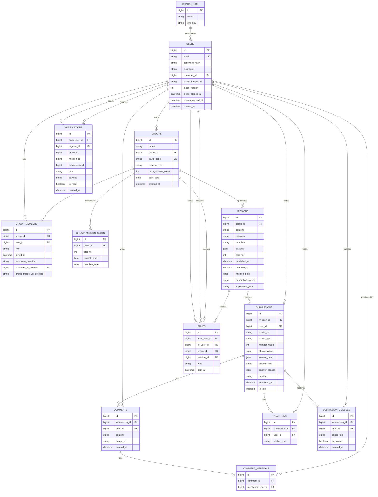

# HA'WE — 백엔드 구성요소 설계

## 계층 구조
- **Controller** (REST API 진입점) → **Service** (비즈니스 로직) → **DAO** (MariaDB 접근, MyBatis)
- 부가 저장소: **로컬 파일 시스템**(이미지, 개발 환경) / **S3**(이미지, 운영 환경 전환 예정), **LLM**(미션 생성 전용, Claude API — B8, 기본 꺼짐), **Qdrant**(벡터 검색, 도입 시 - 필수 X), **SNS/EventBridge**(알림·스케줄)

---

## 1. 도메인 엔티티 & MariaDB 테이블

**비고**
- `USERS.profile_image_url` — 기본 프로필 사진 파일 key(`profiles/uuid.jpg`), 없으면 NULL. API 응답에서는 공개 URL로 변환한다.
- `USERS.token_version` — `INT NOT NULL DEFAULT 0`. 비밀번호 변경 시 1 증가하며, 액세스·리프레시 JWT의 `tv`와 비교한다. 클레임이 없는 기존 토큰은 0으로 읽는다.
- `GROUP_MEMBERS.nickname_override`(`VARCHAR(50)`), `character_id_override`(`BIGINT`, `CHARACTERS.id` FK), `profile_image_url_override`(`VARCHAR(500)`) — 그룹별 닉네임과 캐릭터 또는 사진 파일 key. 모두 NULL이면 기본 프로필을 표시한다. 설정 시 닉네임과 아바타 값 중 정확히 하나를 서비스가 함께 저장한다. 그룹을 나간 작성자의 피드·댓글은 기본 프로필로 표시한다.
- `USERS` 인증 방식 — 소셜 로그인 대신 **이메일/비밀번호 자체 로그인**(`email` + `password_hash`) 사용. 필수 약관 동의 시각을 저장
- `POKES.type` — `poke`(콕찌르기). 예전 `fling`(똥뿌리기) 행이 남아 있어도 조회에서 무시한다 (2026-10-19 삭제)
- `SUBMISSIONS.is_late` — 해당 미션의 `MISSIONS.deadline_at`과 `submitted_at`을 비교해 제출 시점에 계산·저장 (정책 확정)
- `submission_ai_reviews` — 사진 주제 적합도 비동기 결과. `(submission_id, kind)` UNIQUE, `submissions.id` FK. `fit_score`는 DB에만 저장하고 API에는 배지·칭찬 문구만 보낸다. 그룹 삭제·탈퇴 시 제출물보다 먼저 삭제한다 (`VISION_TOPIC_FIT.md`).
- `SUBMISSIONS.media_url` — 이미지 파일 위치(음성은 2026-10-12 제거). 개발 환경은 로컬 경로 저장, 운영 환경은 S3 URL로 전환 예정. 파일이 없는 틀(글/슬라이더)에서는 NULL
- `COMMENTS.image_url` — 첨부 이미지의 저장 키. API에는 공개 파일 URL을 내려준다. 이미지만 있는 댓글은 `content = ''`로 저장한다.
- `REACTIONS` — `(submission_id, user_id, sticker_type)` 유니크 키로 같은 멤버의 같은 스티커 중복을 막는다. 서로 다른 스티커는 각각 누를 수 있다.
- `MISSIONS.template` / `MISSIONS.params` — 미션 틀(예: `TEXT_ACROSTIC`)과 그 빈칸 값(JSON). 틀 목록과 `params` 모양은 `docs/BACKEND/MISSIONS_API.md` §1이 기준
- 제출 답은 **하이브리드 방식**으로 저장한다 (아래 "제출 답 저장 방식"). 집계하는 값은 컬럼(`number_value`, `choice_value`), 그 밖의 답은 JSON(`answer_data`)이다. 사진·그림=`media_*`, 슬라이더·별점=`number_value`, 밸런스 게임=`choice_value`, 글=`answer_data.text`, 다수결 예측의 예측값=`answer_data.guess`. 쓰지 않는 컬럼은 NULL이며, 틀별 필수 여부는 DB가 아니라 서비스가 검증한다
- `SUBMISSIONS.answer_text` / `answer_aliases`, `SUBMISSION_GUESSES` — **미사용(잔재).** 정답 맞히기(G 유형) 용도였으나 2026-10-12 음성 제거로 G 유형 틀이 없어졌다. 스키마는 지우지 않고 유지한다(나중에 서버 기반 맞히기 게임이 생기면 재사용, 탈퇴·그룹 삭제 쿼리가 아직 참조)
- 하루 미션 수 — `GROUPS.daily_mission_count`(1~5, 기본 1)만큼 슬롯(`MISSIONS.slot_no` 1, 2, …)이 열린다. 슬롯별 발행·마감 시각은 `GROUP_MISSION_SLOTS`가 전담하며, **행이 없거나 값이 NULL이면 설정 파일의 기본 시각**(발행 09:00, 마감 23:00 — 초안)을 쓴다. `GROUPS`에는 시각 컬럼이 없다
- 미션 문장 출처·실험 군 — `MISSIONS.generation_source`(`AI`/`AI_FALLBACK`/`PLACEHOLDER`)와 `MISSIONS.experiment_arm`(`AI`/`RANDOM`, 실험 밖이면 NULL). 앱 응답에는 내보내지 않고 비교 리포트에만 쓴다 (B9, `EXPERIMENT_TOPIC.md`)
- `MISSIONS.published_at` / `deadline_at` — 발행 시점의 실제 발행·마감 시각을 고정 저장. 이후 그룹 설정이 바뀌어도 이미 열린 미션의 시각과 지각 판정(`SUBMISSIONS.is_late`)은 바뀌지 않는다
- 유일성 제약 — `GROUP_MISSION_SLOTS (group_id, slot_no)`: 슬롯 재정의는 슬롯당 1행, `MISSIONS (group_id, mission_date, slot_no)`: 그룹·날짜·슬롯당 미션 1개(중복 발행 방지), `SUBMISSIONS (mission_id, user_id)`: 미션당 1인 1회 제출(`ALREADY_SUBMITTED`)
- `NOTIFICATIONS`는 `from_user_id`(발신자, 시스템 알림은 NULL) / `to_user_id`(수신자)로 분리한다. V3에서 알림의 `group_id`, `mission_id`, `submission_id`(NULL 가능, FK 없음)와 목록·미읽음 인덱스를 추가했다. `payload`는 새 앱 안 알림에서 사용하지 않는다.
- 도장(참잘했어요/벌점)은 별도 테이블 없이 `SUBMISSIONS` 존재 여부로 계산 (해당 그룹·날짜에 제출 기록이 있으면 참잘했어요, 없으면 벌점). 하루 미션이 여러 개면 **미션별 도장**이다 (B7 결정, `MISSIONS_API.md` §11-8)

ERD와 컬럼 변경 상세는 이 문서의 위 ERD와 아래 "스키마 변경 상세"를 참고.

### 미션/제출/그룹 스케줄 스키마 변경 상세 (V3 마이그레이션 기준)

근거: `docs/BACKEND/MISSIONS_API.md` §2 (그룹 설정 연동), §9. 현재 상태는 `V1__initial_schema.sql`, `V2__unique_group_members.sql`이다.

**`groups`**

현재 1차 Group 계약에서 `invite_code CHAR(6) NOT NULL UNIQUE`(전체 그룹 유일)와 `start_date DATE NULL`(COUPLE 전용)를 추가했다. 기존 개발 DB는 통합 V1 마이그레이션에 맞춰 재초기화한다.

| 컬럼 | 변경 | 타입 | NULL | 설명 |
|---|---|---|---|---|
| `relation_type` | 추가 | `VARCHAR(20)` | NOT NULL, DEFAULT 'CASUAL' | 그룹 관계 코드 `COUPLE`/`FAMILY`/`FRIEND`/`RIVAL`/`CASUAL`. 유효한 코드인지는 서비스에서 검증 (ENUM 대신 VARCHAR — 코드 추가 시 마이그레이션 불필요). 미션 생성 AI에게 톤·금지 주제를 알려주는 입력으로만 쓰이고 틀 선택에는 쓰지 않는다 |
| `daily_mission_count` | 추가 | `TINYINT UNSIGNED` | NOT NULL, DEFAULT 1 | 하루에 열 미션 수. 허용 범위 1~5는 서비스에서 검증 (상한은 초안). DEFAULT 1이라 기존 그룹은 동작이 그대로다 |
| `mission_publish_time` | **삭제** | `TIME` | - | 슬롯 테이블로 대체 (현재 데이터가 없어 이전 없이 삭제) |
| `mission_deadline_time` | **삭제** | `TIME` | - | 위와 같음 |

**`group_mission_slots` (신규 테이블)** — 슬롯별 시각 재정의. 재정의하지 않은 슬롯은 행이 없다.

| 컬럼 | 타입 | NULL | 설명 |
|---|---|---|---|
| `id` | `BIGINT AUTO_INCREMENT` | PK | |
| `group_id` | `BIGINT` | NOT NULL | FK → `groups.id` (제약명 제안: `fk_group_mission_slots_group`) |
| `slot_no` | `TINYINT UNSIGNED` | NOT NULL | 1~`daily_mission_count`. 범위 검증은 서비스에서 수행 |
| `publish_time` | `TIME` | NULL | NULL이면 설정 파일의 기본 발행 시각 사용 |
| `deadline_time` | `TIME` | NULL | NULL이면 설정 파일의 기본 마감 시각 사용 |
| `(group_id, slot_no)` | UNIQUE | - | 슬롯당 1행. 제약명 제안: `uk_group_mission_slots_group_slot` |

- 실제 적용 시각은 `COALESCE(slot.publish_time, 설정 파일의 기본 발행 시각)` 방식으로 계산한다(마감도 동일). 슬롯 1~N 전체의 유효 시각은 행이 없는 슬롯까지 서비스가 펼쳐서 만든다. 기본 시각은 DB가 아니라 설정 파일(`hawe.mission.*`)에 있으므로, 값을 바꾸고 재시작하면 지정하지 않은 모든 그룹에 적용된다.
- 설정 API에서 `missionSlots`를 보내면 전체 교체이므로, 서비스는 해당 그룹의 행을 지우고 다시 넣는다. `daily_mission_count`를 줄이면 범위 밖 `slot_no` 행은 함께 지운다.

**`missions`**

| 컬럼 | 변경 | 타입 | NULL | 설명 |
|---|---|---|---|---|
| `template` | 추가 | `VARCHAR(40)` | NOT NULL | 틀 코드 (`PHOTO_NOW`, `TEXT_ACROSTIC` 등). 코드값 검증은 서비스에서 수행 (DB ENUM/CHECK 사용 안 함 — 틀이 늘 때마다 마이그레이션이 필요해지므로) |
| `params` | 추가 | `JSON` | NOT NULL | 틀별 빈칸 값. 빈칸이 없는 틀은 `{}`. 대상 지정 틀은 `targetUserId` 포함 |
| `slot_no` | 추가 | `TINYINT UNSIGNED` | NOT NULL, DEFAULT 1 | 그날 몇 번째 미션인지 (1부터) |
| `published_at` | 추가 | `DATETIME` | NOT NULL | 실제 발행 시각 (발행 시점의 유효 시각을 고정) |
| `deadline_at` | 추가 | `DATETIME` | NOT NULL | 마감 시각. `is_late` 판정 기준 |
| `(group_id, mission_date, slot_no)` | UNIQUE 추가 | - | - | 그룹·날짜·슬롯당 미션 1개 (중복 발행 방지). 제약명 제안: `uk_missions_group_date_slot` |

- `mission_date`는 `published_at`의 날짜다. 마감이 자정을 넘기는 경우는 미정이다 (`MISSIONS_API.md` §11).

**`submissions`**

| 컬럼 | 변경 | 타입 | NULL | 설명 |
|---|---|---|---|---|
| `image_url` | `media_url`로 이름 변경, NULL 허용 | `VARCHAR(500)` | NULL | 글/슬라이더 제출은 파일이 없음 |
| `media_type` | 추가 | `VARCHAR(10)` | NULL | `IMAGE` (음성 제거로 `AUDIO`는 더 이상 저장하지 않음). `media_url`이 있을 때만 값이 있음 |
| `number_value` | 추가 | `TINYINT UNSIGNED` | NULL | 별점(1~5) 또는 슬라이더 위치(0~100). 평균·분포를 집계하므로 컬럼으로 둔다 |
| `choice_value` | 추가 | `CHAR(1)` | NULL | 밸런스 게임 선택 `A` / `B`. 비율을 집계하므로 컬럼으로 둔다 |
| `answer_data` | 추가 | `JSON` | NULL | 집계하지 않는 나머지 답. 글 본문(`{"text":"..."}`: 삼행시 3줄, 한 단어, 한 줄 후기, 빈칸 채우기), 다수결 예측의 예측값(`{"guess":70}`), 2차 틀의 구조적인 답. 모양은 틀마다 `MISSIONS_API.md`에서 정의하고 서비스가 검증한다 |
| `answer_text` | 추가 | `VARCHAR(100)` | NULL | **미사용(잔재).** 정답 맞히기의 대표 정답 용도였으나 음성 제거로 쓰는 틀이 없음 |
| `answer_aliases` | 추가 | `JSON` | NULL | **미사용(잔재).** 정답 맞히기의 별칭 배열 용도였으나 음성 제거로 쓰는 틀이 없음 |
| `caption` | 변경 없음 | `TEXT` | NULL | 보조 설명. 길이 제한(200자)은 서비스에서 수행 |
| `(mission_id, user_id)` | UNIQUE 추가 | - | - | 미션당 1인 1회. 제약명 제안: `uk_submissions_mission_user` |

**제출 답 저장 방식 (하이브리드)** — 앞으로 만들 V3 기준의 결정.

기존 설계의 `text_value`, `guess_value` 컬럼은 만들지 않고 `answer_data JSON` 하나로 합친다. `number_value`, `choice_value`는 컬럼으로 둔다.

| 구분 | 저장 위치 | 기준 |
|---|---|---|
| 집계·필터에 쓰는 값 | 컬럼 (`number_value`, `choice_value`) | `AVG`, `GROUP BY`, `WHERE`가 SQL 한 줄로 끝나고 DB가 타입을 보장 |
| 보여주기만 하는 값, 틀마다 모양이 다른 값 | JSON (`answer_data`) | 새 틀이 생겨도 마이그레이션이 필요 없음 |

- **`answer_data` 예시:** 글 틀 `{"text":"퇴근길
..."}`, 다수결 예측 `{"guess":70}` (내 슬라이더 위치는 `number_value`). 키 이름과 필수 여부는 틀별로 정하고 서비스(`MissionTemplateValidator`)가 검증한다. DB는 JSON 유효성만 보장한다.
- **글 길이 제한(500자)** 은 컬럼 길이가 아니라 서비스 검증으로 한다.
- **승격 규칙:** `answer_data` 안의 키를 집계하거나 검색해야 하게 되면 그 키를 컬럼으로 승격하는 마이그레이션을 새로 만든다. 처음부터 집계 대상인 값은 JSON에 넣지 않는다.
- **MyBatis:** JSON 컬럼은 문자열로 읽고 쓰며(`missions.params`, `answer_aliases`와 같은 방식), 서비스에서 Jackson으로 변환하거나 공용 `JsonTypeHandler`를 쓴다.
- **`answer_text`, `answer_aliases`는 이 방식과 별개다.** 정답 맞히기(G 유형)의 정답용 별도 컬럼이었으나, 음성 제거로 현재는 쓰지 않는 잔재다.
- **API와의 관계:** 제출 요청 필드(`text`, `number`, `guess`, `choice`)는 `MISSIONS_API.md` 그대로이고 저장 위치만 다르다. `number`→`number_value`, `choice`→`choice_value`, `text`→`answer_data.text`, `guess`→`answer_data.guess`. 응답도 기존 필드명(`text`, `guess`)으로 내려주며, 서비스가 JSON에서 꺼내 채운다.

**`submission_guesses` (신규 테이블)** — 정답 시도 기록. **미사용(잔재):** 2026-10-12 음성 제거로 정답 맞히기가 폐기되어 쓰지 않지만 테이블은 유지한다.

| 컬럼 | 타입 | NULL | 설명 |
|---|---|---|---|
| `id` | `BIGINT AUTO_INCREMENT` | PK | |
| `submission_id` | `BIGINT` | NOT NULL | 대상 제출물. FK → `submissions.id` (제약명 제안: `fk_submission_guesses_submission`) |
| `user_id` | `BIGINT` | NOT NULL | 시도한 멤버. FK → `users.id` (제약명 제안: `fk_submission_guesses_user`) |
| `guess_text` | `VARCHAR(100)` | NOT NULL | 입력한 정답 원문 |
| `is_correct` | `BOOLEAN` | NOT NULL | 정답 여부 (서비스가 비교해서 저장) |
| `created_at` | `DATETIME` | NOT NULL, DEFAULT CURRENT_TIMESTAMP | 시도 시각 |
| `(submission_id, user_id)` | INDEX | - | 사용자별 시도 횟수 조회용. UNIQUE가 아님. 이름 제안: `idx_submission_guesses_submission_user` |

- 정답을 맞혔는지는 `is_correct = TRUE`인 행이 있는지로 판단한다.
- 시도 횟수 상한은 설정 `hawe.mission.guess-max-attempts`(초안 3)로 서비스가 검사한다 (DB 제약 아님). 동시에 겹친 요청이 상한을 한 번 더 넘길 수 있으나 영향이 작아 허용한다 (초안).

**마이그레이션 시 확인할 것**
- **전제:** 현재 개발 DB에는 데이터가 전혀 없다. 따라서 V3는 백필·이전·중복 정리 없이 단순하게 쓸 수 있다.
  - `missions`의 NOT NULL 컬럼(`template`, `params`, `published_at`, `deadline_at`)을 바로 추가한다 (`slot_no`는 DEFAULT 1).
  - `groups.mission_publish_time`, `mission_deadline_time`을 이전 없이 바로 `DROP COLUMN` 한다.
  - `submissions.image_url` → `media_url` 변경에 값 채우기가 필요 없다 (`media_type` 포함).
  - UNIQUE 제약(`missions`, `submissions`) 추가 전 중복 정리가 필요 없다.
- **V3 적용 전에 확인:** 데이터가 없다는 것은 현재 개발 DB 기준이다. V1/V2가 적용된 다른 DB(팀원 로컬, 서버 등)가 있다면 그곳도 비어 있는지 확인한다. 데이터가 있다면 NOT NULL 컬럼 값 채우기(`template='PHOTO_NOW'`, `params='{}'`, 그룹 시각 기반 `published_at`/`deadline_at`), 기존 그룹 시각의 슬롯 1번 행 이전, UNIQUE 중복 정리(가장 작은 `id` 유지)를 `groups` 컬럼 삭제 **전에** 해야 한다.
- 이미 적용된 `V1`/`V2` 파일은 수정하지 않는다 (Flyway 체크섬 불일치). 변경은 새 `V3` 파일로 한다.
- 코드 영향
  - 메인 코드의 `GroupMapper.findSummariesByUserId`, `GroupMemberMapper.findMembersByGroupId`는 `submissions`/`missions`를 `mission_id`, `user_id`, `group_id`, `mission_date`로만 읽으므로 컬럼 변경에는 영향이 없다. `submissionCountThisMonth`는 B7에서 제출 행 수 대신 이번 달 제출한 날 수로 바꿨다 (`MISSIONS_API.md` §11-9).
  - **`GroupMapperTests`(`summariesAndMembersMapSubmissionValues`)가 `submissions`에 `image_url`로, `missions`에 `template`/`params`/`published_at`/`deadline_at` 없이 직접 INSERT하므로 V3 적용 후 실패한다.** V3와 함께 테스트의 INSERT를 새 컬럼 기준으로 고쳐야 한다. (`comments.image_url`은 다른 테이블이라 이번 변경 대상이 아니다.)
  - 그룹 모듈(`Group` 도메인, `GroupMapper`의 INSERT/UPDATE/SELECT, `GroupCreateRequest`, `GroupSettingsUpdateRequest`, `GroupResponse`, `GroupService`)은 삭제되는 `missionPublishTime`/`missionDeadlineTime` 대신 `daily_mission_count`와 슬롯 지정을 다루도록 별도 수정이 필요하다. `relation_type`도 생성·수정·조회 DTO에 포함해야 한다. `GroupMapperTests`의 `insertGroup`도 시각 세팅을 제거해야 한다.
- 추가 인덱스는 필요 없다. `missions`의 UNIQUE 제약이 그룹별 날짜 조회의 인덱스 역할을 하고, `submissions`의 UNIQUE 제약이 피드 조회(`mission_id`)의 인덱스 역할을 하며, `user_id`와 `group_mission_slots.group_id`는 FK 인덱스가 있다.

---

## 2. 서비스 컴포넌트

| Service | 책임 |
|---|---|
| `AuthService` | 회원가입/로그인(자체 인증), 비밀번호 해싱, JWT 발급·검증 |
| `GroupService` | 그룹 생성/초대/설정(하루 미션 수, 슬롯별 시각)/멤버 관리 |
| `MissionService` | 슬롯별 미션 발행(스케줄러 트리거 → 서버가 틀 선택 → LLM으로 문장·빈칸 생성 → 서버 검증 → 저장, 실패 시 예비 미션), 오늘 열린 미션 목록·단건 조회 |
| `MissionScheduleService` | 그룹의 슬롯별 유효 발행·마감 시각 계산(지정 없으면 설정 파일의 기본 시각), 설정 변경 시 스케줄 재등록, 다음 발행 예정 시각 계산 |
| `MissionTemplateValidator` | 틀별 `params` 검증(미션 생성 시)과 제출 필드 검증(제출 시). 틀마다 검증기 1개 |
| `MissionTemplateSelector` | 슬롯별 틀 선택(하루 내 매체 중복 방지, 하루 1개일 때 어제와 매체 중복 방지, 후보 부족 시 예외 허용, 관계별 선호 없음)과 대상 멤버 지정(빈칸 채우기는 항상, 그림 틀은 설정된 확률). 어제 미션만 조회하고 시드 기반으로 계산 (`MISSIONS_API.md` §6-1) |
| `SubmissionService` | 제출 처리(지각 판정, 중복 제출 차단), 잠금 해제 여부 판단 |
| `MissionResultService` | 집계 틀(밸런스 게임, 슬라이더 3종)의 그룹 결과 계산 |
| ~~`GuessService`~~ | 폐기됨 (음성 제거로 정답 맞히기 없음, `MISSIONS_API.md` §4-1) |
| `FileStorageService` | 이미지 파일 저장/조회 (개발=로컬, 운영=S3로 전환), 형식·크기 검증 |
| `FeedService` | 그룹 피드 조회 (제출자만 열람 가능하도록 필터링) |
| `CommentService` | 댓글 작성, @멘션 파싱, 사진 첨부 |
| `ReactionService` | 스티커 반응 등록/집계 |
| `PokeService` | 콕찌르기 전송 → 알림 트리거 |
| `NotificationService` | 알림 생성·조회·읽음 처리, SNS 푸시 발송 |
| `CalendarService` | 마이페이지 달력/기록 집계 (사용자 기준 전체 그룹 통합) |
| `CharacterService` | 캐릭터 목록 조회, 프로필 캐릭터 선택 |
| `RecallService` (선택) | Qdrant 기반 — 과거 비슷한 감정의 게시물 찾기 |

---

## 3. API 엔드포인트

### 인증
- `POST /api/auth/register` — 회원가입 (`email`, `password`, `nickname`, `agreeTerms`, `agreePrivacy`)
- `POST /api/auth/login` — 로그인 (`email`, `password`) → JWT 발급
- `POST /api/auth/refresh` — 토큰 갱신
- `GET /api/me` — 내 계정 정보

### 그룹
- `GET /api/groups` — 내 그룹 목록 (오늘 제출 여부 포함)
- `POST /api/groups` — 그룹 생성 (`name`, 선택: `relationType`, COUPLE의 `startDate`, `dailyMissionCount`, `missionSlots`)
- `GET /api/groups/{groupId}/members` — 멤버 목록 + 이번 달 제출 횟수
- `PATCH /api/groups/{groupId}/settings` — 그룹명/관계(`relationType`)/COUPLE 시작일(`startDate`)/하루 미션 수/슬롯별 시각 변경
- `GET /api/invites/{code}` — 6자리 코드로 그룹 미리보기
- `POST /api/groups/join` — 코드로 그룹 참여
- `DELETE /api/groups/{groupId}/members/me` — 그룹 나가기(그룹장은 `successorUserId` 지정, 마지막 멤버는 그룹 삭제)

### 미션 & 제출 (상세 명세: `docs/BACKEND/MISSIONS_API.md`)
- `GET /api/groups/{groupId}/missions/today` — 오늘 열린 미션 목록(슬롯 순서, 틀 `template` + 빈칸 `params` 포함) + 내 제출 여부 + 다음 발행 예정 시각
- `GET /api/missions/{missionId}` — 미션 단건
- `GET /api/mission-templates` — 틀 목록과 빈칸/제출 형식
- `POST /api/missions/{missionId}/submissions` — 미션 제출 (`multipart/form-data`: `file`, `text`, `number`, `guess`, `choice`, `caption` 중 틀이 요구하는 필드만)
  - 개발/운영 환경 공통으로 서버가 파일을 직접 받음 (API 계약 동일)
  - 저장 위치만 환경별로 다름: 개발 환경은 로컬 디스크, 운영 환경은 내부적으로 S3 업로드 (presigned URL 방식은 사용하지 않음 — 클라이언트 변경 없이 저장소만 전환)
- `GET /api/missions/{missionId}/submissions` — 그룹 피드 (내가 제출했을 때만 200, 아니면 423 Locked)
- `GET /api/missions/{missionId}/result` — 집계 틀의 그룹 결과 (제출한 사람만, 집계 틀이 아니면 400)
- `GET /internal/experiments/topic` — AI 주제 vs 랜덤 주제 비교 리포트 (내부용, 헤더 `X-Admin-Token`, 틀리면 404. B9 — `EXPERIMENT_TOPIC.md`)
- ~~`POST /api/submissions/{id}/guesses`~~ — 폐기됨 (음성 제거로 정답 맞히기 틀 없음)

### 게시물 & 댓글
- `GET /api/submissions/{id}` — 게시물 상세 (미션에 제출한 사람만)
- `POST /api/submissions/{id}/comments` — 댓글 작성 (`@멘션`, `imageUrl` 포함)
- `POST /api/submissions/{id}/reactions` — 스티커 반응

### 재촉 기능
- `POST /api/groups/{groupId}/pokes` — 콕찌르기 (`toUserId`, `type`, 선택 `missionId` — 없으면 첫 슬롯의 현재 미션). 보내는 사람(`fromUserId`)은 인증 토큰에서 식별한다. `pokes.mission_id`는 현재 미션 FK이며 `(from_user_id, to_user_id, mission_id, type)`에 UNIQUE 제약을 둔다. 응답은 `missionId`를 포함하고 현재 미션의 `members[].pokedByMe`는 요청자가 보낸 종류를 표시한다. 알림 발송은 9단계에서 연결한다.

### 마이페이지
- `GET /api/me/calendar?month=2026-09` — 이번 달 도장 현황 (그룹 통합)
- `GET /api/me/calendar/{date}` — 특정 날짜의 그룹별 미션/제출 상세

### 알림
- `GET /api/notifications` — 모든 그룹의 내 알림 목록 (`topic`의 `fromUser`는 NULL)
- `GET /api/notifications/unread-count` — 안 읽은 알림 개수
- `PATCH /api/notifications/{id}/read` — 읽음 처리
- `PATCH /api/notifications/read-all` — 전체 읽음 처리

### 캐릭터
- `GET /api/characters` — 선택 가능한 캐릭터 목록
- `PATCH /api/me/character` — 프로필 캐릭터 변경

---

### Group insights cache

`group_insights` has one row per `(group_id, month)` with `GENERATING`, `READY`, or `FAILED` status, structured JSON payload, generation/expiration timestamps, attempts, and an updated timestamp for five minute abandoned job recovery. It references `groups` and is deleted before group deletion. Results expire through the second day of the following month; after that, they become permanent only when all missions from the month have closed. See [GROUP_INSIGHTS.md](GROUP_INSIGHTS.md).

## 4. 비동기·스케줄 처리
- **EventBridge Scheduler** → 매일 그룹별·슬롯별 발행 시각(지정이 없으면 설정 파일의 기본 발행 시각)에 `MissionService.publishDailyMission(groupId, date, slotNo)` 호출
  - 같은 그룹·날짜·슬롯의 미션이 이미 있으면 중단 → 서버가 틀 선택 → LLM으로 `{content, category, params}` 생성 → 서버 검증(`MissionTemplateValidator`) → 대상 지정 틀이면 멤버 1명 무작위 선택 → 저장(`published_at`, `deadline_at` 고정) → `topic` 알림
  - LLM 실패/검증 실패가 반복되면 예비 미션으로 대체 (상세: `docs/BACKEND/MISSIONS_API.md` §6)
- 미션 발행/댓글/멘션/콕찌르기 커밋 뒤 `NotificationService`가 앱 안 알림을 `NOTIFICATIONS` 테이블에 기록한다. 푸시 발송은 아직 구현하지 않았다.

## 5. Qdrant(VectorDB) 활용 (선택 기능)
- 제출 캡션을 임베딩하여 저장
- "1년 전 오늘과 비슷한 감정의 글" 같은 회고형 기능에 활용 가능 (마이페이지 확장 아이디어)
- 초기 MVP에는 필수 아님 — 위 API에는 포함하지 않음, 추후 `RecallService`로 별도 확장
