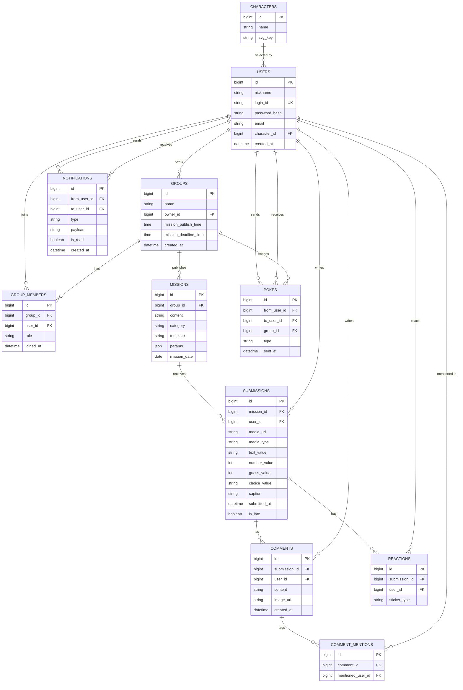

# HA'WE — 백엔드 구성요소 설계 (ver0.1)

## 계층 구조
- **Controller** (REST API 진입점) → **Service** (비즈니스 로직) → **DAO** (MariaDB 접근, MyBatis)
- 부가 저장소: **로컬 파일 시스템**(이미지·음성, 개발 환경) / **S3**(이미지·음성, 운영 환경 전환 예정), **LLM**(미션 생성·판정, 제공사 미정), **Qdrant**(벡터 검색, 도입 시 - 필수 X), **SNS/EventBridge**(알림·스케줄)

---

## 1. 도메인 엔티티 & MariaDB 테이블

**비고**
- `USERS` 인증 방식 — 소셜 로그인 대신 **자체 로그인**(`login_id` + `password_hash`) 사용. `email`은 부가 정보로 저장
- `POKES.type` — `poke`(콕찌르기) / `fling`(똥뿌리기)
- `SUBMISSIONS.is_late` — 그룹별 `GROUPS.mission_deadline_time`과 `submitted_at`을 비교해 판단 (정책 확정)
- `SUBMISSIONS.media_url` — 이미지·음성 파일 위치. 개발 환경은 로컬 경로 저장, 운영 환경은 S3 URL로 전환 예정. 파일이 없는 틀(글/슬라이더)에서는 NULL
- `MISSIONS.template` / `MISSIONS.params` — 미션 틀(예: `TEXT_ACROSTIC`)과 그 빈칸 값(JSON). 틀 목록과 `params` 모양은 `docs/BACKEND/MISSIONS_API.md` §1이 기준
- 틀에 따라 쓰는 제출 컬럼이 다르다 (사진·그림·음성=`media_*`, 글=`text_value`, 슬라이더·별점=`number_value`, 다수결 예측=`number_value`+`guess_value`, 밸런스 게임=`choice_value`). 쓰지 않는 컬럼은 NULL이며, 틀별 필수 여부는 DB가 아니라 서비스가 검증한다
- 유일성 제약 — `MISSIONS (group_id, mission_date)`: 그룹당 하루 미션 1개(중복 발행 방지), `SUBMISSIONS (mission_id, user_id)`: 미션당 1인 1회 제출(`ALREADY_SUBMITTED`)
- `NOTIFICATIONS`는 `from_user_id`(발신자, 시스템 알림은 NULL) / `to_user_id`(수신자)로 분리
- 도장(참잘했어요/벌점)은 별도 테이블 없이 `SUBMISSIONS` 존재 여부로 계산 (해당 그룹·날짜에 제출 기록이 있으면 참잘했어요, 없으면 벌점)

상세 ERD/FK 참조 흐름/컬럼 설명은 `docs/DB/DB_DESIGN_ver0.1.md` 참고.

### 미션/제출 스키마 변경 상세 (V3 마이그레이션 기준)

근거: `docs/BACKEND/MISSIONS_API.md` §9. 현재 상태는 `V1__initial_schema.sql`이다.

**`missions`**

| 컬럼 | 변경 | 타입 | NULL | 설명 |
|---|---|---|---|---|
| `template` | 추가 | `VARCHAR(40)` | NOT NULL | 틀 코드 (`PHOTO_NOW`, `TEXT_ACROSTIC` 등). 코드값 검증은 서비스에서 수행 (DB ENUM/CHECK 사용 안 함 — 틀이 늘 때마다 마이그레이션이 필요해지므로) |
| `params` | 추가 | `JSON` | NOT NULL | 틀별 빈칸 값. 빈칸이 없는 틀은 `{}`. 대상 지정 틀은 `targetUserId` 포함 |
| `(group_id, mission_date)` | UNIQUE 추가 | - | - | 중복 발행 방지. 제약명 제안: `uk_missions_group_date` |

**`submissions`**

| 컬럼 | 변경 | 타입 | NULL | 설명 |
|---|---|---|---|---|
| `image_url` | `media_url`로 이름 변경, NULL 허용 | `VARCHAR(500)` | NULL | 글/슬라이더 제출은 파일이 없음 |
| `media_type` | 추가 | `VARCHAR(10)` | NULL | `IMAGE` / `AUDIO`. `media_url`이 있을 때만 값이 있음 |
| `text_value` | 추가 | `VARCHAR(500)` | NULL | 글 본문 (삼행시 3줄, 한 단어, 한 줄 후기, 빈칸 채우기). 줄바꿈 포함 |
| `number_value` | 추가 | `TINYINT UNSIGNED` | NULL | 별점(1~5) 또는 슬라이더 위치(0~100) |
| `guess_value` | 추가 | `TINYINT UNSIGNED` | NULL | 다수결 예측의 예측값(0~100) |
| `choice_value` | 추가 | `CHAR(1)` | NULL | 밸런스 게임 선택 `A` / `B` |
| `caption` | 변경 없음 | `TEXT` | NULL | 보조 설명. 길이 제한(200자)은 서비스에서 수행 |
| `(mission_id, user_id)` | UNIQUE 추가 | - | - | 미션당 1인 1회. 제약명 제안: `uk_submissions_mission_user` |

**마이그레이션 시 확인할 것**
- 두 UNIQUE 제약은 기존 데이터에 중복이 있으면 추가에 실패한다. `V2__unique_group_members.sql`처럼 제약 추가 전에 중복을 정리(가장 작은 `id`만 유지)해야 한다. 현재는 미션/제출을 만드는 코드가 없어 데이터가 거의 없을 것으로 예상되지만 개발 DB는 직접 확인한다.
- `missions.template`, `missions.params`는 NOT NULL이라 기존 행이 있으면 값을 채워야 한다. 기존 제출은 모두 이미지였으므로 백필 기본값은 `template='PHOTO_NOW'`, `params='{}'`을 권장한다. 행이 없으면 불필요하다.
- `submissions` 기존 행은 `media_url`로 이름을 바꾸면서 `media_type='IMAGE'`로 채운다.
- 코드 영향: 메인 코드(`GroupMapper`, `GroupMemberMapper`)는 `submissions`/`missions`를 `mission_id`, `user_id`, `group_id`, `mission_date`로만 읽으므로 영향이 없다. **단 `GroupMapperTests`(`summariesAndMembersMapSubmissionValues`)가 `submissions`에 `image_url`로, `missions`에 `template`/`params` 없이 직접 INSERT하므로 V3 적용 후 실패한다.** V3와 함께 테스트의 INSERT를 `media_url`, `template`, `params` 기준으로 고쳐야 한다. (`comments.image_url`은 다른 테이블이라 이번 변경 대상이 아니다.)
- 추가 인덱스는 필요 없다. UNIQUE 제약이 피드 조회(`mission_id`)와 그룹별 날짜 조회(`group_id`, `mission_date`)의 인덱스 역할을 하고, `user_id`는 FK 인덱스가 이미 있다.

**검토 사항 (MISSIONS_API에는 없음, 결정 필요)**
- `GET /missions/today` 응답의 `publishedAt` / `deadlineAt`은 현재 그룹 설정(`mission_publish_time`, `mission_deadline_time`)과 `mission_date`로 계산한다. 그룹장이 설정을 바꾸면 과거 미션의 표시 시각도 바뀌므로, 필요하면 `missions`에 `published_at`, `deadline_at` 컬럼을 두어 발행 시점 값을 고정하는 방안이 있다. (`is_late`는 제출 시점에 계산해 저장하므로 이미 고정된다.) 추가하려면 `MISSIONS_API.md`도 함께 수정한다.

---

## 2. 서비스 컴포넌트

| Service | 책임 |
|---|---|
| `AuthService` | 회원가입/로그인(자체 인증), 비밀번호 해싱, JWT 발급·검증 |
| `GroupService` | 그룹 생성/초대/설정/멤버 관리 |
| `MissionService` | 미션 발행(스케줄러 트리거 → LLM 호출 → 서버 검증 → 저장, 실패 시 예비 미션), 미션 조회 |
| `MissionTemplateValidator` | 틀별 `params` 검증(미션 생성 시)과 제출 필드 검증(제출 시). 틀마다 검증기 1개 |
| `SubmissionService` | 제출 처리(지각 판정, 중복 제출 차단), 잠금 해제 여부 판단 |
| `MissionResultService` | 집계 틀(밸런스 게임, 슬라이더 3종)의 그룹 결과 계산 |
| `FileStorageService` | 이미지·음성 파일 저장/조회 (개발=로컬, 운영=S3로 전환), 형식·크기 검증 |
| `FeedService` | 그룹 피드 조회 (제출자만 열람 가능하도록 필터링) |
| `CommentService` | 댓글 작성, @멘션 파싱, 사진 첨부 |
| `ReactionService` | 스티커 반응 등록/집계 |
| `PokeService` | 콕찌르기/똥뿌리기 전송 → 알림 트리거 |
| `NotificationService` | 알림 생성·조회·읽음 처리, SNS 푸시 발송 |
| `CalendarService` | 마이페이지 달력/기록 집계 (사용자 기준 전체 그룹 통합) |
| `CharacterService` | 캐릭터 목록 조회, 프로필 캐릭터 선택 |
| `RecallService` (선택) | Qdrant 기반 — 과거 비슷한 감정의 게시물 찾기 |

---

## 3. API 엔드포인트

### 인증
- `POST /api/auth/register` — 회원가입 (`loginId`, `password`, `nickname`, `email`)
- `POST /api/auth/login` — 로그인 (`loginId`, `password`) → JWT 발급
- `POST /api/auth/refresh` — 토큰 갱신

### 그룹
- `GET /api/groups` — 내 그룹 목록 (오늘 제출 여부 포함)
- `POST /api/groups` — 그룹 생성 (`name`, `missionPublishTime`, `missionDeadlineTime`)
- `GET /api/groups/{groupId}/members` — 멤버 목록 + 이번 달 제출 횟수
- `PATCH /api/groups/{groupId}/settings` — 그룹명/미션 발행·마감 시각 등 변경
- `POST /api/groups/{groupId}/invite` — 초대 링크 발급
- `DELETE /api/groups/{groupId}/members/me` — 그룹 나가기

### 미션 & 제출 (상세 명세: `docs/BACKEND/MISSIONS_API.md`)
- `GET /api/groups/{groupId}/missions/today` — 오늘의 미션(틀 `template` + 빈칸 `params` 포함) + 내 제출 여부
- `GET /api/missions/{missionId}` — 미션 단건
- `GET /api/mission-templates` — 틀 목록과 빈칸/제출 형식
- `POST /api/missions/{missionId}/submissions` — 미션 제출 (`multipart/form-data`: `file`, `text`, `number`, `guess`, `choice`, `caption` 중 틀이 요구하는 필드만)
  - 개발/운영 환경 공통으로 서버가 파일을 직접 받음 (API 계약 동일)
  - 저장 위치만 환경별로 다름: 개발 환경은 로컬 디스크, 운영 환경은 내부적으로 S3 업로드 (presigned URL 방식은 사용하지 않음 — 클라이언트 변경 없이 저장소만 전환)
- `GET /api/missions/{missionId}/submissions` — 그룹 피드 (내가 제출했을 때만 200, 아니면 423 Locked)
- `GET /api/missions/{missionId}/result` — 집계 틀의 그룹 결과 (제출한 사람만, 집계 틀이 아니면 400)

### 게시물 & 댓글
- `GET /api/submissions/{id}` — 게시물 상세 (미션에 제출한 사람만)
- `POST /api/submissions/{id}/comments` — 댓글 작성 (`@멘션`, `imageUrl` 포함)
- `POST /api/submissions/{id}/reactions` — 스티커 반응

### 재촉 기능
- `POST /api/groups/{groupId}/pokes` — 콕찌르기/똥뿌리기 (`toUserId`, `type`). 보내는 사람(`fromUserId`)은 인증 토큰에서 식별

### 마이페이지
- `GET /api/me/calendar?month=2026-09` — 이번 달 도장 현황 (그룹 통합)
- `GET /api/me/calendar/{date}` — 특정 날짜의 그룹별 미션/제출 상세

### 알림
- `GET /api/notifications` — 알림 목록 (발신자 정보는 `fromUserId`가 있는 경우에만 포함, 시스템 알림은 없음)
- `PATCH /api/notifications/{id}/read` — 읽음 처리

### 캐릭터
- `GET /api/characters` — 선택 가능한 캐릭터 목록
- `PATCH /api/me/character` — 프로필 캐릭터 변경

---

## 4. 비동기·스케줄 처리
- **EventBridge Scheduler** → 매일 그룹별 설정 시각(`mission_publish_time`)에 `MissionService.publishDailyMission()` 호출
  - 같은 그룹·날짜의 미션이 이미 있으면 중단 → LLM으로 `{content, category, template, params}` 생성 → 서버 검증(`MissionTemplateValidator`) → 대상 지정 틀이면 멤버 1명 무작위 선택 → 저장 → `mission_open` 알림
  - LLM 실패/검증 실패가 반복되면 예비 미션으로 대체 (상세: `docs/BACKEND/MISSIONS_API.md` §6)
- 제출/댓글/멘션/콕찌르기 발생 시 `NotificationService`가 `NOTIFICATIONS` 테이블에 기록 + **SNS**로 푸시 발송 (비동기, 이벤트 기반)

## 5. Qdrant(VectorDB) 활용 (선택 기능)
- 제출 캡션을 임베딩하여 저장
- "1년 전 오늘과 비슷한 감정의 글" 같은 회고형 기능에 활용 가능 (마이페이지 확장 아이디어)
- 초기 MVP에는 필수 아님 — 위 API에는 포함하지 않음, 추후 `RecallService`로 별도 확장
