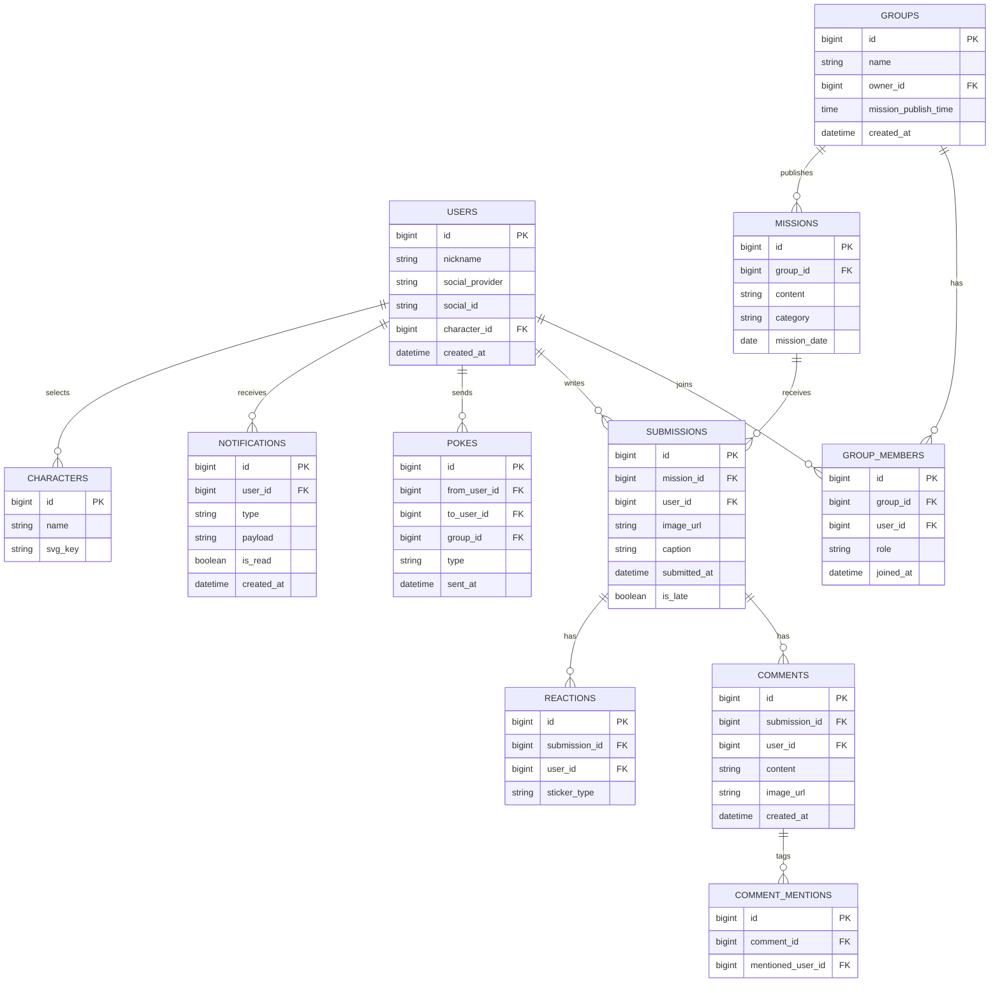

# HA'WE — 백엔드 구성요소 설계

## 계층 구조
- **Controller** (REST API 진입점) → **Service** (비즈니스 로직) → **Repository** (MariaDB 접근, MyBatis)
- 부가 저장소: **S3**(이미지), **Qdrant**(벡터 검색, 벡터 검색 도입시-필수 X), **SNS/EventBridge**(알림·스케줄)

---

## 1. 도메인 엔티티 & MariaDB 테이블

**비고**
- `POKES.type` — `poke`(콕찌르기) / `fling`(똥뿌리기)
- `SUBMISSIONS.is_late` — 마감 이후 제출 여부(추후 정책 확정 시 사용)
- 도장(참잘했어요/벌점)은 별도 테이블 없이 `SUBMISSIONS` 존재 여부로 계산 (해당 그룹·날짜에 제출 기록이 있으면 참잘했어요, 없으면 벌점)

---

## 2. 서비스 컴포넌트

| Service | 책임 |
|---|---|
| `AuthService` | 소셜 로그인, JWT 발급/검증 |
| `GroupService` | 그룹 생성/초대/설정/멤버 관리 |
| `MissionService` | 미션 발행(스케줄러 트리거), 미션 조회 |
| `SubmissionService` | 제출 처리, 잠금 해제 여부 판단 |
| `FeedService` | 그룹 피드 조회 (제출자만 열람 가능하도록 필터링) |
| `CommentService` | 댓글 작성, @멘션 파싱, 사진 첨부 |
| `ReactionService` | 스티커 반응 등록/집계 |
| `PokeService` | 콕찌르기/똥뿌리기 전송 → 알림 트리거 |
| `NotificationService` | 알림 생성·조회·읽음 처리, SNS 푸시 발송 |
| `CalendarService` | 마이페이지 달력/기록 집계 (사용자 기준 전체 그룹 통합) |
| `CharacterService` | 캐릭터 목록 조회, 프로필 캐릭터 선택 |
| `RecallService` (선택) | Qdrant 기반 — 과거 비슷한 감정의 게시물 찾기 |

---

## 3. API 엔드포인트

### 인증
- `POST /api/auth/login` — 소셜 로그인
- `POST /api/auth/refresh` — 토큰 갱신

### 그룹
- `GET /api/groups` — 내 그룹 목록 (오늘 제출 여부 포함)
- `POST /api/groups` — 그룹 생성
- `GET /api/groups/{groupId}/members` — 멤버 목록 + 이번 달 제출 횟수
- `PATCH /api/groups/{groupId}/settings` — 그룹명/미션 시간 등 변경
- `POST /api/groups/{groupId}/invite` — 초대 링크 발급
- `DELETE /api/groups/{groupId}/members/me` — 그룹 나가기

### 미션 & 제출
- `GET /api/groups/{groupId}/missions/today` — 오늘의 미션 + 내 제출 여부
- `POST /api/missions/{missionId}/submissions` — 미션 제출 (이미지 S3 업로드 URL은 사전 발급)
- `GET /api/missions/{missionId}/submissions` — 그룹 피드 (내가 제출했을 때만 200, 아니면 423 Locked)

### 게시물 & 댓글
- `GET /api/submissions/{id}` — 게시물 상세
- `POST /api/submissions/{id}/comments` — 댓글 작성 (`@멘션`, `imageUrl` 포함)
- `POST /api/submissions/{id}/reactions` — 스티커 반응

### 재촉 기능
- `POST /api/groups/{groupId}/pokes` — 콕찌르기/똥뿌리기 (`toUserId`, `type`)

### 마이페이지
- `GET /api/me/calendar?month=2026-09` — 이번 달 도장 현황 (그룹 통합)
- `GET /api/me/calendar/{date}` — 특정 날짜의 그룹별 미션/제출 상세

### 알림
- `GET /api/notifications` — 알림 목록
- `PATCH /api/notifications/{id}/read` — 읽음 처리

### 캐릭터
- `GET /api/characters` — 선택 가능한 캐릭터 목록
- `PATCH /api/me/character` — 프로필 캐릭터 변경

---

## 4. 비동기·스케줄 처리
- **EventBridge Scheduler** → 매일 그룹별 설정 시각에 `MissionService.publishDailyMission()` 호출
- 제출/댓글/멘션/콕찌르기 발생 시 `NotificationService`가 `NOTIFICATIONS` 테이블에 기록 + **SNS**로 푸시 발송 (비동기, 이벤트 기반)

## 5. Qdrant(VectorDB) 활용 (선택 기능)
- 제출 캡션을 임베딩하여 저장
- "1년 전 오늘과 비슷한 감정의 글" 같은 회고형 기능에 활용 가능 (마이페이지 확장 아이디어)
- 초기 MVP에는 필수 아님 — 위 API에는 포함하지 않음, 추후 `RecallService`로 별도 확장
