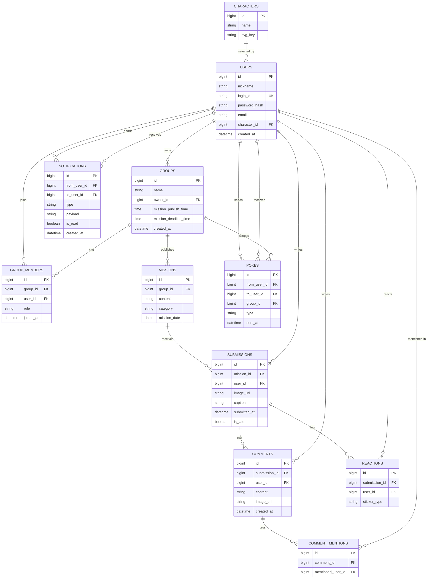

# HA'WE — DB 설계 ver0.1

## 1. ERD

## 2. FK 참조 흐름

| 참조하는 컬럼 | 참조되는 컬럼 | 비고 |
|---|---|---|
| USERS.character_id | CHARACTERS.id | 선택한 캐릭터 |
| GROUPS.owner_id | USERS.id | 그룹장 |
| GROUP_MEMBERS.group_id | GROUPS.id | |
| GROUP_MEMBERS.user_id | USERS.id | |
| MISSIONS.group_id | GROUPS.id | |
| SUBMISSIONS.mission_id | MISSIONS.id | |
| SUBMISSIONS.user_id | USERS.id | |
| COMMENTS.submission_id | SUBMISSIONS.id | |
| COMMENTS.user_id | USERS.id | |
| COMMENT_MENTIONS.comment_id | COMMENTS.id | |
| COMMENT_MENTIONS.mentioned_user_id | USERS.id | |
| REACTIONS.submission_id | SUBMISSIONS.id | |
| REACTIONS.user_id | USERS.id | |
| POKES.from_user_id | USERS.id | 보낸 사람 |
| POKES.to_user_id | USERS.id | 받는 사람 |
| POKES.group_id | GROUPS.id | 어느 그룹 내 재촉인지 |
| NOTIFICATIONS.from_user_id | USERS.id | 발신자, 시스템 알림(미션 발행 등)은 NULL |
| NOTIFICATIONS.to_user_id | USERS.id | 수신자 |

전체 흐름을 요약하면: `CHARACTERS` ← `USERS` ← (`GROUPS`, `GROUP_MEMBERS`) ← `MISSIONS` ← `SUBMISSIONS` ← (`COMMENTS` ← `COMMENT_MENTIONS`, `REACTIONS`) 순으로 참조가 이어지고, `POKES`·`NOTIFICATIONS`는 `USERS`(및 `POKES`는 `GROUPS`)를 양방향(발신/수신)으로 참조하는 구조입니다.

## 3. 테이블 및 컬럼 설명

### USERS
| 컬럼 | 설명 |
|---|---|
| id | PK |
| nickname | 닉네임 |
| login_id | 로그인 ID (고유값) |
| password_hash | 비밀번호 해시값 |
| email | 이메일 |
| character_id | 선택한 프로필 캐릭터 (FK → CHARACTERS.id) |
| created_at | 가입 시각 |

> ver0.1 변경: `social_provider`/`social_id` 제거(소셜 로그인 보류), `login_id`/`password_hash`/`email` 신규 추가(자체 로그인 방식으로 전환).

### GROUPS
| 컬럼 | 설명 |
|---|---|
| id | PK |
| name | 그룹명 |
| owner_id | 그룹장 (FK → USERS.id) |
| mission_publish_time | 매일 미션이 열리는 시각 |
| mission_deadline_time | 매일 미션 제출 마감 시각 (그룹별 커스텀) |
| created_at | 그룹 생성 시각 |

> ver0.1 변경: `mission_deadline_time` 신규 추가 — `SUBMISSIONS.is_late` 판단 기준(그룹별 커스텀 마감 시각)을 저장하기 위함.

### GROUP_MEMBERS
| 컬럼 | 설명 |
|---|---|
| id | PK |
| group_id | 소속 그룹 (FK → GROUPS.id) |
| user_id | 멤버 유저 (FK → USERS.id) |
| role | 그룹 내 역할 (예: owner/member) |
| joined_at | 그룹 가입 시각 |

### MISSIONS
| 컬럼 | 설명 |
|---|---|
| id | PK |
| group_id | 소속 그룹 (FK → GROUPS.id) |
| content | 미션 내용 |
| category | 미션 카테고리 |
| mission_date | 미션이 적용되는 날짜 |

### SUBMISSIONS
| 컬럼 | 설명 |
|---|---|
| id | PK |
| mission_id | 대상 미션 (FK → MISSIONS.id) |
| user_id | 제출자 (FK → USERS.id) |
| image_url | 첨부 이미지 경로 |
| caption | 제출 캡션 |
| submitted_at | 제출 시각 |
| is_late | 마감 이후 제출 여부 (그룹별 `mission_deadline_time` 기준으로 판단) |

> ver0.1 변경: `image_url`은 개발 환경에서 로컬 경로를 저장(추후 S3 URL로 전환 예정). `is_late`는 그룹별 `mission_deadline_time`과 `submitted_at`을 비교해 판단하는 정책으로 확정.

### COMMENTS
| 컬럼 | 설명 |
|---|---|
| id | PK |
| submission_id | 대상 게시물 (FK → SUBMISSIONS.id) |
| user_id | 작성자 (FK → USERS.id) |
| content | 댓글 내용 |
| image_url | 첨부 이미지 |
| created_at | 작성 시각 |

### COMMENT_MENTIONS
| 컬럼 | 설명 |
|---|---|
| id | PK |
| comment_id | 대상 댓글 (FK → COMMENTS.id) |
| mentioned_user_id | 멘션된 유저 (FK → USERS.id) |

### REACTIONS
| 컬럼 | 설명 |
|---|---|
| id | PK |
| submission_id | 대상 게시물 (FK → SUBMISSIONS.id) |
| user_id | 반응한 유저 (FK → USERS.id) |
| sticker_type | 스티커 종류 |

### POKES
| 컬럼 | 설명 |
|---|---|
| id | PK |
| from_user_id | 보낸 유저 (FK → USERS.id) |
| to_user_id | 받는 유저 (FK → USERS.id) |
| group_id | 재촉이 발생한 그룹 (FK → GROUPS.id) |
| type | poke(콕찌르기) / fling(똥뿌리기) |
| sent_at | 전송 시각 |

### NOTIFICATIONS
| 컬럼 | 설명 |
|---|---|
| id | PK |
| from_user_id | 발신자 (FK → USERS.id, 시스템 알림은 NULL) |
| to_user_id | 수신자 (FK → USERS.id) |
| type | 알림 종류 |
| payload | 부가 정보 (문자열) |
| is_read | 읽음 여부 |
| created_at | 생성 시각 |

> ver0.1 변경: `user_id` 단일 컬럼을 `from_user_id`/`to_user_id`로 분리(발신자/수신자 구분).

### CHARACTERS
| 컬럼 | 설명 |
|---|---|
| id | PK |
| name | 캐릭터 이름 |
| svg_key | 프론트엔드 SVG 에셋 매핑 키 |
