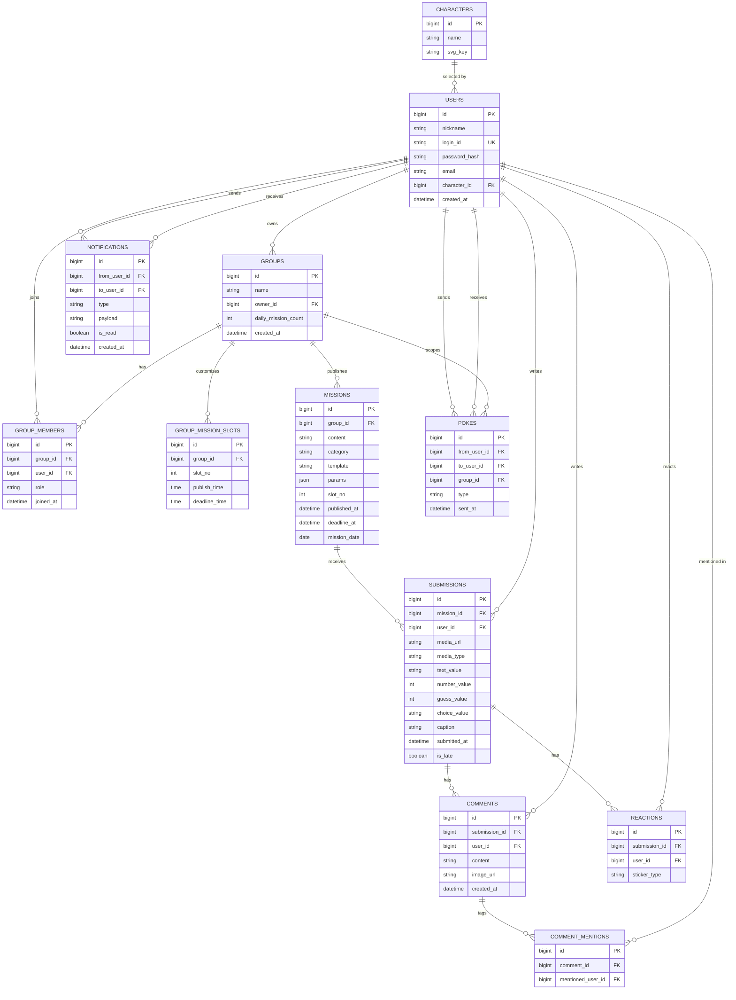

# HA'WE — DB 설계 ver0.1

## 1. ERD

## 2. FK 참조 흐름

| 참조하는 컬럼 | 참조되는 컬럼 | 비고 |
|---|---|---|
| USERS.character_id | CHARACTERS.id | 선택한 캐릭터 |
| GROUPS.owner_id | USERS.id | 그룹장 |
| GROUP_MEMBERS.group_id | GROUPS.id | |
| GROUP_MEMBERS.user_id | USERS.id | |
| GROUP_MISSION_SLOTS.group_id | GROUPS.id | 슬롯별 시각 재정의를 가진 그룹 |
| MISSIONS.group_id | GROUPS.id | |
| SUBMISSIONS.mission_id | MISSIONS.id | |
| SUBMISSIONS.user_id | USERS.id | |
| COMMENTS.submission_id | SUBMISSIONS.id | |
| COMMENTS.user_id | USERS.id | |
| COMMENT_MENTIONS.comment_id | COMMENTS.id | |
| COMMENT_MENTIONS.mentioned_user_id | USERS.id | |
| REACTIONS.submission_id | SUBMISSIONS.id | |
| REACTIONS.user_id | USERS.id | |
| POKES.from_user_id | USERS.id | 보낸 사람 |
| POKES.to_user_id | USERS.id | 받는 사람 |
| POKES.group_id | GROUPS.id | 어느 그룹 내 재촉인지 |
| NOTIFICATIONS.from_user_id | USERS.id | 발신자, 시스템 알림(미션 발행 등)은 NULL |
| NOTIFICATIONS.to_user_id | USERS.id | 수신자 |

전체 흐름을 요약하면: `CHARACTERS` ← `USERS` ← (`GROUPS`, `GROUP_MEMBERS`) ← (`GROUP_MISSION_SLOTS`, `MISSIONS`) ← `SUBMISSIONS` ← (`COMMENTS` ← `COMMENT_MENTIONS`, `REACTIONS`) 순으로 참조가 이어지고, `POKES`·`NOTIFICATIONS`는 `USERS`(및 `POKES`는 `GROUPS`)를 양방향(발신/수신)으로 참조하는 구조입니다.

## 3. 테이블 및 컬럼 설명

### USERS
| 컬럼 | 설명 |
|---|---|
| id | PK |
| nickname | 닉네임 |
| login_id | 로그인 ID (고유값) |
| password_hash | 비밀번호 해시값 |
| email | 이메일 |
| character_id | 선택한 프로필 캐릭터 (FK → CHARACTERS.id) |
| created_at | 가입 시각 |

> ver0.1 변경: `social_provider`/`social_id` 제거(소셜 로그인 보류), `login_id`/`password_hash`/`email` 신규 추가(자체 로그인 방식으로 전환).

### GROUPS
| 컬럼 | 설명 |
|---|---|
| id | PK |
| name | 그룹명 |
| owner_id | 그룹장 (FK → USERS.id) |
| daily_mission_count | 하루에 여는 미션 수 (1~5, 기본 1) |
| created_at | 그룹 생성 시각 |

> ver0.1 변경: `mission_deadline_time` 신규 추가 — `SUBMISSIONS.is_late` 판단 기준(그룹별 커스텀 마감 시각)을 저장하기 위함.
> V3 변경: `daily_mission_count` 신규 추가(NOT NULL, DEFAULT 1). `mission_publish_time`/`mission_deadline_time` 삭제 — 시각은 `GROUP_MISSION_SLOTS`가 전담하고, 지정이 없으면 서버 코드의 기본 시각(발행 09:00, 마감 23:00 — 초안)을 사용. 기존 그룹의 값은 V3에서 슬롯 1번 행으로 이전.

### GROUP_MISSION_SLOTS
슬롯(그날 몇 번째 미션인지)별 발행·마감 시각을 **지정한 경우에만** 행이 생긴다. 지정하지 않은 슬롯은 행이 없고 서버 코드의 기본 시각(발행 09:00, 마감 23:00 — 초안)을 쓴다.

| 컬럼 | 설명 |
|---|---|
| id | PK |
| group_id | 소속 그룹 (FK → GROUPS.id) |
| slot_no | 미션 순번 (1~`GROUPS.daily_mission_count`). 범위 검증은 서비스에서 수행 |
| publish_time | 이 슬롯의 발행 시각. NULL이면 서버 코드의 기본 발행 시각 사용 |
| deadline_time | 이 슬롯의 마감 시각. NULL이면 서버 코드의 기본 마감 시각 사용 |

> V3 신규 테이블. UNIQUE `(group_id, slot_no)`. 실제 적용 시각은 `COALESCE(슬롯 값, 서버 기본값)`.

### GROUP_MEMBERS
| 컬럼 | 설명 |
|---|---|
| id | PK |
| group_id | 소속 그룹 (FK → GROUPS.id) |
| user_id | 멤버 유저 (FK → USERS.id) |
| role | 그룹 내 역할 (예: owner/member) |
| joined_at | 그룹 가입 시각 |

### MISSIONS
| 컬럼 | 설명 |
|---|---|
| id | PK |
| group_id | 소속 그룹 (FK → GROUPS.id) |
| content | 미션 내용 |
| category | 미션 카테고리 |
| template | 미션 틀 코드 (예: `TEXT_ACROSTIC`). 유효한 코드인지는 서비스에서 검증 |
| params | 틀의 빈칸 값 (JSON, 예: `{"word":"퇴근길"}`). 빈칸이 없는 틀은 `{}`. 대상 지정 틀은 `targetUserId` 포함 |
| slot_no | 그날 몇 번째 미션인지 (1부터, 기본 1) |
| published_at | 실제 발행 시각 (발행 시점의 유효 시각을 고정 저장) |
| deadline_at | 마감 시각. `SUBMISSIONS.is_late` 판단 기준 |
| mission_date | 미션이 적용되는 날짜 (`published_at`의 날짜) |

> V3 변경: `template`, `params`, `slot_no`, `published_at`, `deadline_at` 신규 추가. UNIQUE `(group_id, mission_date, slot_no)` — 그룹·날짜·슬롯당 미션 1개(중복 발행 방지). 틀 목록과 `params` 모양은 `docs/BACKEND/MISSIONS_API.md` §1 참고.

### SUBMISSIONS
| 컬럼 | 설명 |
|---|---|
| id | PK |
| mission_id | 대상 미션 (FK → MISSIONS.id) |
| user_id | 제출자 (FK → USERS.id) |
| media_url | 첨부 파일(이미지·음성) 경로. 글/슬라이더처럼 파일이 없는 제출은 NULL |
| media_type | 파일 종류 `IMAGE` / `AUDIO` (`media_url`이 있을 때만 값 있음) |
| text_value | 글로 쓴 답 (삼행시, 한 단어 일기, 한 줄 후기, 빈칸 채우기). 없으면 NULL |
| number_value | 숫자 답: 별점(1~5) 또는 슬라이더 위치(0~100). 없으면 NULL |
| guess_value | 다수결 예측의 예측값(0~100). 해당 틀에서만 값 있음 |
| choice_value | 밸런스 게임 선택 `A` / `B`. 해당 틀에서만 값 있음 |
| caption | 제출 캡션(보조 설명) |
| submitted_at | 제출 시각 |
| is_late | 마감 이후 제출 여부 (해당 미션의 `deadline_at` 기준으로 판단) |

> ver0.1 변경: `image_url`은 개발 환경에서 로컬 경로를 저장(추후 S3 URL로 전환 예정). `is_late`는 마감 시각과 `submitted_at`을 비교해 판단하는 정책으로 확정.
> V3 변경: `image_url`을 `media_url`로 이름 변경(NULL 허용)하고 `media_type`, `text_value`, `number_value`, `guess_value`, `choice_value` 추가. 틀에 따라 필요한 칸만 채우고 나머지는 NULL이며, 틀별 필수 여부는 서비스가 검증. UNIQUE `(mission_id, user_id)` — 미션당 1인 1회 제출. `is_late` 기준이 그룹 설정 마감 시각에서 미션의 `deadline_at`으로 바뀜.

### COMMENTS
| 컬럼 | 설명 |
|---|---|
| id | PK |
| submission_id | 대상 게시물 (FK → SUBMISSIONS.id) |
| user_id | 작성자 (FK → USERS.id) |
| content | 댓글 내용 |
| image_url | 첨부 이미지 |
| created_at | 작성 시각 |

### COMMENT_MENTIONS
| 컬럼 | 설명 |
|---|---|
| id | PK |
| comment_id | 대상 댓글 (FK → COMMENTS.id) |
| mentioned_user_id | 멘션된 유저 (FK → USERS.id) |

### REACTIONS
| 컬럼 | 설명 |
|---|---|
| id | PK |
| submission_id | 대상 게시물 (FK → SUBMISSIONS.id) |
| user_id | 반응한 유저 (FK → USERS.id) |
| sticker_type | 스티커 종류 |

### POKES
| 컬럼 | 설명 |
|---|---|
| id | PK |
| from_user_id | 보낸 유저 (FK → USERS.id) |
| to_user_id | 받는 유저 (FK → USERS.id) |
| group_id | 재촉이 발생한 그룹 (FK → GROUPS.id) |
| type | poke(콕찌르기) / fling(똥뿌리기) |
| sent_at | 전송 시각 |

### NOTIFICATIONS
| 컬럼 | 설명 |
|---|---|
| id | PK |
| from_user_id | 발신자 (FK → USERS.id, 시스템 알림은 NULL) |
| to_user_id | 수신자 (FK → USERS.id) |
| type | 알림 종류 |
| payload | 부가 정보 (문자열) |
| is_read | 읽음 여부 |
| created_at | 생성 시각 |

> ver0.1 변경: `user_id` 단일 컬럼을 `from_user_id`/`to_user_id`로 분리(발신자/수신자 구분).

### CHARACTERS
| 컬럼 | 설명 |
|---|---|
| id | PK |
| name | 캐릭터 이름 |
| svg_key | 프론트엔드 SVG 에셋 매핑 키 |
