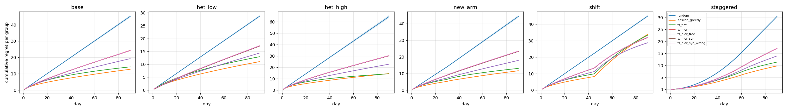

# D1 보고서 — 미션 틀 선택 밴딧 시뮬레이션

작성 2026-11-23 · 담당 2번 우준 · 계획 `docs/TODO_2/D1-simulator-and-seed.md` · 근거 `docs/FEATURE/AI_FEATURES.md` §4

지금 서버는 미션 틀(사진·글·그림의 6가지 형식)을 **규칙 안에서 무작위**로 고른다. "그룹마다 참여가 잘 되는 틀 위주로,
다른 틀도 가끔 시도"하는 **멀티 암드 밴딧**으로 바꾸면 얼마나 나아지는지, 어떤 설정이 좋은지를 **합성 환경**에서 비교했다.

> **주의.** 그룹·틀별 참여율은 가정치다(`env.py`). 실제 사용자 데이터는 쓰지 않았다. 아래 수치는 "이런 환경이라면"의
> 상대 비교이며 실제 효과를 증명하지 않는다. 실제 효과는 서버 연결(D4) 뒤 실측으로만 말한다(AI_FEATURES.md §4.7).

## 한눈에

| 질문 | 답 (기본 시나리오, 시드 30개, 그룹 200개, 90일) |
|---|---|
| 밴딧이 무작위보다 나은가 | **예.** 계층 TS(`ts_hier`)의 누적 후회가 무작위의 **54%**(45.2 → 24.3). 마지막 30일 멤버당 보상 0.440 → 0.482(**+9.5%**) |
| 안전장치(반복 패널티·점유율 상한)의 비용은 | 후회가 안전장치 없는 버전(19.3)보다 **26% 큼**. 대신 한 틀이 7일 동안 40%를 넘게 나온 그룹·일이 **28%로 무작위(29%)와 같은 수준**. 안전장치가 없으면 47%, 단순 밴딧은 55~69%로 한 틀에 쏠린다 |
| 취향이 바뀌면 | 단순 밴딧(ε-greedy, 그룹별 TS)은 바뀐 뒤 **무작위보다 못해진다**(마지막 30일 0.432~0.441 vs 무작위 0.437). 시간 감쇠가 있는 계층 TS 는 0.460~0.468 로 회복 |
| AI 합성 시드(출발값)는 도움이 되나 | **측정되는 이득이 없다.** 그룹 20개·순차 가입에서도 K_syn 0~50 차이가 신뢰구간 안. 순위를 뒤집은 "틀린 시드"도 K_syn ≤ 10 이면 피해가 보이지 않는다 |
| 계층(전역 → 그룹 수축) 강도 κ | **작게(κ = 2)** 가 가장 좋다. 초안 10 은 그룹 취향을 너무 전체 평균 쪽으로 당겨 후회가 6% 크다(24.3 vs 23.0). 계층이 전혀 없는 것(κ = 0)보다는 가입 직후 2주 후회가 4% 작다 |
| 탐색 하한 ε | 0 이 수치로는 가장 좋고 0.05 는 후회 +3%. "모든 후보를 가끔은 낸다"는 제품 규칙이라 **0.05 유지**(비용 작음) |

**D4(서버 연결)에 권장하는 값:** κ = **2**(초안 10에서 변경), ε = 0.05, 반복 패널티 ×0.85/3일, 점유율 상한 40%/7일, 반감기 30일.
**합성 시드(LLM 으로 출발값 만들기)는 생략을 권장**한다 — 이 환경에서 이득이 없고 LLM 호출 비용과 "LLM 의 믿음을 데이터처럼 쓴다"는 부담만 남는다. 새 틀은 Beta(1,1) + 전역 분포로 시작해도 충분했다(`new_arm` 시나리오).

## 1. 환경 (`env.py`)

| 항목 | 값 | 근거 |
|---|---|---|
| 틀(팔) | 6종: 지금 이 순간·갤러리 발굴·색깔 사냥(사진), 삼행시·빈칸 채우기(글), A를 B로(그림) | 서버 기본 발행 풀. 30초 스케치는 2026-10-19 팀 결정으로 빠짐 |
| 후보 규칙 | 하루 1개: 어제 매체를 뺀 매체들의 틀 전체 / 하루 2~3개: 슬롯이 매체를 정함(그 매체 안의 틀만) / 같은 날 같은 매체가 다시 오면 다음 틀 | 서버 `MissionTemplateSelector` 와 D4 계획 — 밴딧이 고를 수 있는 폭이 원래 작다 |
| 그룹 | 멤버 2~6명(연인 2·그 외 최대 6), 하루 미션 1개 60%·2개 25%·3개 15% | 서버 정원 |
| 참여 | 멤버마다 `제출 확률 = sigmoid(틀 기본 + 그룹의 틀 취향 + 멤버 활동성)`, 제출하면 정성 `q` | 틀 기본값은 가정치(사진 > 글 > 그림 순으로 살짝 높게) |
| 보상 | 멤버 `r = 제출 × (0.6 + 0.2·effort + 0.2·engage)`, 미션 `R = Σr`, 대상 인원 `n` | AI_FEATURES.md §4.2 · D2 와 같은 식 |
| 갱신 | 미션이 닫히면(그날 끝) 그 틀의 `α += R`, `β += n − R` | 분수 보상이라 근사(§4.8) |

시나리오: `base`(그룹 간 취향 차이 중간), `het_low`/`het_high`(차이 작음/큼), `new_arm`(30일째 그림 틀이 새로 들어옴),
`shift`(45일째 그룹 취향이 뒤집힘), `staggered`(그룹이 60일에 걸쳐 차례로 가입 — 커지는 서비스).

지표: **누적 후회**(그날 후보 중 가장 좋은 틀의 기대 보상 − 고른 틀의 기대 보상, 그룹당 합), 멤버당 보상, 가장 좋은 후보를 고른 비율,
**점유율 40% 넘은 그룹·일**(최근 7일 미션이 5개 이상인데 한 틀이 40% 넘게 나온 비율 — 쏠림).

## 2. 정책 (`policies.py`)

| 정책 | 설명 |
|---|---|
| `random` | 지금 서버. 후보 중 무작위 |
| `epsilon_greedy` | 비교용. 그룹별 평균이 가장 높은 틀, 10% 는 무작위 |
| `ts_flat` | 비교용. 그룹마다 Beta(1,1) 에서 시작하는 Thompson Sampling |
| `ts_hier` | AI_FEATURES.md §4.3: 전역 분포로 그룹 분포를 수축(κ=10) + 탐색 하한 ε=0.05 + 최근 3일 쓴 틀 ×0.85 + 7일 점유율 40% 상한 + 반감기 30일 |
| `ts_hier_free` | `ts_hier` 에서 반복 패널티·점유율 상한만 뺀 것(안전장치 비용 확인용) |
| `ts_hier_syn` / `_wrong` | `ts_hier` + 합성 prior K_syn=10. 정답 근처 prior / 순위를 뒤집은 prior |

## 3. 결과 — 정책 비교 (시드 30개 평균 ± 95% 신뢰구간 반폭, 그룹 200개, 90일)



*날짜별 누적 후회(그룹당, 낮을수록 좋음). 계층 TS 세 가지(`ts_hier`, `_syn`, `_syn_wrong`)는 거의 겹친다.*

| 시나리오 | 정책 | 누적 후회 90일 | 후회 가입 뒤 첫 14일 | 보상/인원 가입 뒤 첫 14일 | 보상/인원 마지막 30일 | 최선 후보 고른 비율 | 점유율 40% 넘은 그룹·일 |
|---|---|---|---|---|---|---|---|
| base | random | 45.15 ± 0.71 | 7.09 ± 0.12 | 0.440 ± 0.003 | 0.440 ± 0.002 | 48.2% ± 0.5 | 29.0% ± 0.5 |
| base | epsilon_greedy | 12.77 ± 0.22 | 3.87 ± 0.06 | 0.479 ± 0.003 | 0.505 ± 0.002 | 74.5% ± 0.7 | 68.6% ± 1.1 |
| base | ts_flat | 14.24 ± 0.14 | 4.87 ± 0.06 | 0.467 ± 0.002 | 0.508 ± 0.003 | 72.5% ± 0.5 | 55.4% ± 1.0 |
| base | ts_hier | 24.31 ± 0.26 | 5.20 ± 0.07 | 0.462 ± 0.003 | 0.482 ± 0.002 | 62.7% ± 0.5 | 28.1% ± 0.5 |
| base | ts_hier_free | 19.27 ± 0.20 | 4.79 ± 0.07 | 0.467 ± 0.003 | 0.493 ± 0.002 | 67.5% ± 0.6 | 46.9% ± 0.9 |
| base | ts_hier_syn | 24.20 ± 0.27 | 5.08 ± 0.07 | 0.463 ± 0.003 | 0.482 ± 0.002 | 62.8% ± 0.5 | 28.0% ± 0.6 |
| base | ts_hier_syn_wrong | 24.27 ± 0.29 | 5.25 ± 0.07 | 0.461 ± 0.002 | 0.482 ± 0.002 | 62.8% ± 0.5 | 28.2% ± 0.6 |
| het_low | random | 28.71 ± 0.38 | 4.53 ± 0.06 | 0.443 ± 0.002 | 0.442 ± 0.002 | 48.0% ± 0.4 | 29.1% ± 0.4 |
| het_low | ts_flat | 12.95 ± 0.15 | 3.55 ± 0.05 | 0.453 ± 0.002 | 0.477 ± 0.002 | 65.8% ± 0.5 | 50.2% ± 0.7 |
| het_low | ts_hier | 17.18 ± 0.19 | 3.29 ± 0.05 | 0.456 ± 0.002 | 0.464 ± 0.002 | 60.0% ± 0.4 | 24.9% ± 0.4 |
| het_low | ts_hier_free | 14.38 ± 0.14 | 3.08 ± 0.04 | 0.458 ± 0.002 | 0.470 ± 0.002 | 64.0% ± 0.4 | 43.6% ± 0.6 |
| het_high | random | 64.44 ± 1.26 | 10.11 ± 0.21 | 0.434 ± 0.003 | 0.433 ± 0.003 | 48.0% ± 0.3 | 29.0% ± 0.3 |
| het_high | ts_flat | 14.33 ± 0.16 | 5.99 ± 0.09 | 0.484 ± 0.004 | 0.541 ± 0.004 | 77.9% ± 0.4 | 59.6% ± 0.5 |
| het_high | ts_hier | 30.21 ± 0.43 | 7.01 ± 0.11 | 0.471 ± 0.004 | 0.505 ± 0.003 | 65.8% ± 0.3 | 31.8% ± 0.3 |
| het_high | ts_hier_free | 22.76 ± 0.30 | 6.37 ± 0.12 | 0.479 ± 0.004 | 0.520 ± 0.004 | 71.3% ± 0.3 | 50.9% ± 0.5 |
| new_arm | random | 44.41 ± 0.74 | 6.65 ± 0.14 | 0.468 ± 0.002 | 0.438 ± 0.002 | 47.5% ± 0.3 | 31.3% ± 0.4 |
| new_arm | ts_flat | 13.13 ± 0.17 | 4.15 ± 0.07 | 0.497 ± 0.002 | 0.509 ± 0.003 | 73.3% ± 0.4 | 60.7% ± 0.8 |
| new_arm | ts_hier | 23.42 ± 0.30 | 4.84 ± 0.08 | 0.488 ± 0.002 | 0.483 ± 0.002 | 62.9% ± 0.4 | 29.6% ± 0.5 |
| shift | random | 44.93 ± 0.52 | 7.00 ± 0.10 | 0.439 ± 0.002 | 0.437 ± 0.002 | 48.3% ± 0.5 | 29.0% ± 0.4 |
| shift | epsilon_greedy | 33.77 ± 0.51 | 3.90 ± 0.06 | 0.476 ± 0.002 | **0.432 ± 0.003** | 56.5% ± 0.4 | 67.9% ± 1.0 |
| shift | ts_flat | 33.37 ± 0.47 | 4.87 ± 0.07 | 0.465 ± 0.002 | **0.441 ± 0.003** | 56.7% ± 0.4 | 52.0% ± 0.7 |
| shift | ts_hier | 31.96 ± 0.34 | 5.13 ± 0.07 | 0.461 ± 0.002 | 0.460 ± 0.002 | 56.9% ± 0.4 | 25.8% ± 0.5 |
| shift | ts_hier_free | 28.72 ± 0.33 | 4.78 ± 0.06 | 0.465 ± 0.002 | 0.468 ± 0.002 | 59.6% ± 0.4 | 44.2% ± 0.8 |
| staggered | random | 30.50 ± 0.49 | 7.15 ± 0.10 | 0.441 ± 0.003 | 0.440 ± 0.003 | 47.6% ± 0.3 | 19.2% ± 0.3 |
| staggered | ts_flat | 11.40 ± 0.10 | 4.86 ± 0.06 | 0.468 ± 0.003 | 0.501 ± 0.003 | 69.4% ± 0.5 | 34.6% ± 0.5 |
| staggered | ts_hier | 17.10 ± 0.21 | 5.09 ± 0.07 | 0.464 ± 0.003 | 0.480 ± 0.002 | 61.4% ± 0.4 | 18.0% ± 0.4 |
| staggered | ts_hier_free | 13.97 ± 0.17 | 4.70 ± 0.08 | 0.469 ± 0.003 | 0.490 ± 0.003 | 65.7% ± 0.4 | 30.1% ± 0.5 |

전체 표(모든 정책 × 시나리오)는 `python run.py` 결과 `out/main_summary.md`. 무작위도 점유율 40%를 29% 넘는 건 매체 규칙 때문이다(그림 틀이 하나뿐이라 그림 슬롯은 늘 같은 틀).

읽는 법:
- **모든 학습 정책이 무작위보다 확실히 낫다**(모든 시나리오에서 신뢰구간이 겹치지 않음).
- 단순 밴딧(ε-greedy, 그룹별 TS)은 취향이 고정이면 수치가 가장 좋지만 **한 틀에 쏠리고**(55~73%), **취향이 바뀌면 무너진다**(`shift` 마지막 30일 ≤ 무작위).
- `ts_hier` 는 쏠림을 무작위 수준으로 유지하면서 무작위 대비 후회를 절반 가까이 줄인다. 안전장치를 빼면(`_free`) 후회는 더 줄지만 쏠림이 30~52% 로 오른다 — **팀이 고를 수 있는 손잡이**다(점유율 상한값).

## 4. 파라미터 비교 (`out/sweeps.md`)

### κ — 전역 분포로 그룹 분포를 당기는 강도 (κ = 0 은 계층 없음)

| 시나리오 | κ=0 | κ=2 | κ=5 | κ=10(초안) | κ=20 | κ=50 |
|---|---|---|---|---|---|---|
| base 누적 후회 90일 | 23.29 | **22.95** | 23.59 | 24.31 | 25.20 | 26.79 |
| het_high 누적 후회 90일 | 27.47 | **27.43** | 28.76 | 30.21 | 32.26 | 36.21 |
| staggered 누적 후회 90일 | 16.78 | **16.43** | 16.74 | 17.10 | 17.60 | 18.44 |
| staggered 후회 가입 뒤 첫 14일 | 5.31 | **5.10** | 5.09 | 5.09 | 5.07 | 5.08 |

(모두 ±0.2~0.5) 계층은 **가입 직후**에 조금(약 4%) 도움이 되지만, 강하면 그룹 고유의 취향을 덮는다. 그룹 취향 차이가 클수록 손해가 크다. → **κ = 2 권장.**

### ε — 탐색 하한

| 시나리오 | ε=0 | ε=0.05 | ε=0.1 | ε=0.2 |
|---|---|---|---|---|
| base 누적 후회 90일 | 23.52 | 24.23 | 25.09 | 26.71 |
| shift 누적 후회 90일 | 31.22 | 31.90 | 32.63 | 33.63 |

시간 감쇠가 있으면 취향 변화에도 ε 없이 따라간다. ε = 0.05 의 비용은 후회 +3% 로 작고, "어떤 후보도 가끔은 나온다(ε/후보수 이상)"는 보장이 생긴다 → **0.05 유지.**

### K_syn — AI 합성 출발값의 세기 (맞는 prior / 순위를 뒤집은 틀린 prior)

| 상황 | K_syn=0 | 맞는 prior 10 | 맞는 prior 50 | 틀린 prior 10 | 틀린 prior 50 |
|---|---|---|---|---|---|
| base, 그룹 20개: 후회 가입 뒤 첫 14일 | 5.36 ± 0.25 | 5.14 ± 0.23 | 5.06 ± 0.22 | 5.35 ± 0.23 | 5.56 ± 0.26 |
| staggered, 그룹 20개: 후회 가입 뒤 첫 14일 | 5.11 ± 0.25 | 5.23 ± 0.24 | 5.08 ± 0.21 | 5.33 ± 0.24 | 5.45 ± 0.27 |
| base, 그룹 200개: 후회 가입 뒤 첫 14일 | 5.17 ± 0.07 | 5.12 ± 0.08 | 5.11 ± 0.07 | 5.27 ± 0.07 | 5.28 ± 0.08 |

차이가 모두 신뢰구간 안이다. 합성 prior 는 **전역 평균의 출발점**만 바꾸는데, 전역 평균은 실제 미션 수십 개면 실측으로 채워지고(감쇠 N0 = 50),
그룹 선택은 그룹 자신의 기록이 주도하기 때문이다. 틀린 prior 를 50 으로 세게 넣으면 첫 2주 후회가 살짝 늘어나는 경향(+2~7%, 유의하지 않음)만 보인다.
→ **K_syn ≤ 10 상한은 안전하지만, 이 환경에서는 합성 시드를 만들 이유가 없다.** 계획의 LLM 시드 생성(약 175회 호출)은 하지 않는 것을 권장한다.

## 5. 한계

- 참여율·정성 분포가 **가정치**다. 실제 틀별 참여 차이가 훨씬 작으면 밴딧의 이득도 작아진다(`het_low` 가 그 방향의 예).
- 후회는 "그날 가장 참여가 높은 틀"을 기준으로 잰다. **다양성 자체의 가치**(질리지 않음, 신기함)는 환경에 넣지 않았다 → 안전장치의 이득은 이 수치에 안 보이고 비용만 보인다.
- 분수 보상의 Beta 근사, 요일·시험 기간 같은 문맥 없음, 그룹끼리 독립, 같은 틀 연속의 피로 효과 없음.
- 90일, 하루 최대 3개. 그룹 수 20·200만 봤다.
- 실제 효과는 D4 연결 후 B9 처럼 (그룹, 날짜) 단위로 `bandit`/`random` 날을 무작위 배정해 그룹 안에서 비교해야 말할 수 있다(D5).

## 6. 재현

```bash
cd ml/bandit-sim
./.venv/Scripts/python.exe -m pytest -q tests          # 26 통과, 1 건너뜀(합성 시드 파일 없음)
PYTHONIOENCODING=utf-8 ./.venv/Scripts/python.exe run.py --scenario all --seeds 30   # 이 PC 약 18분
```

같은 명령이면 같은 수치가 나온다. 결과 파일은 `out/`(비커밋), 그래프 사본은 `report/regret.png`.
