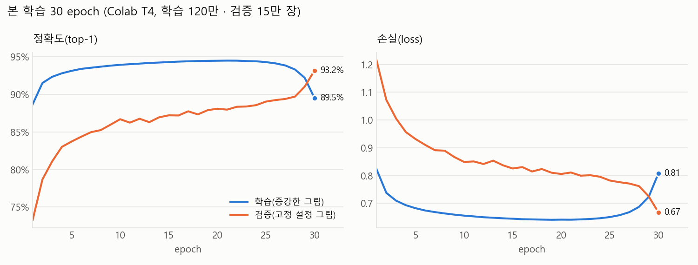

# M1 보고서 — 직접 학습한 그림 인식 모델 ("AI가 맞혀볼게요")

작성 2026-10-16 · 담당 2번 우준 · 계획 `docs/해야될거/2번_우준/M1(완료)-quickdraw-model.md`

그림 미션에서 "AI에게 보여주기"를 누르면 휴대폰이 그림을 보고 무엇인지 맞힌다. 이 문서는 그 모델을 **어떤 데이터로, 어떻게 학습하고, 얼마나 맞히는지** 정리한다.
명령어와 파일 설명은 `README.md`, 앱과의 약속(입출력·전처리)은 `PREPROCESS_SPEC.md`·`export/model_card.md`, 팀원 그림 평가의 자세한 표는 `EVAL.md` 에 있다.

## 한눈에

| 목표 (계획서) | 기준 | 결과 |
|---|---|---|
| 테스트셋 정확도 top-1 | ≥ 75% | **93.1%** ✅ |
| 테스트셋 정확도 top-3 | ≥ 90% | **98.4%** ✅ |
| 모델 크기 | ≤ 1 MB | **158 KB** (int8) ✅ |
| 추론 시간 | 휴대폰 ≤ 30 ms | PC 1.2 ms. 휴대폰 실측은 안 함(입력이 28×28 이라 충분히 작다) |
| 팀원이 앱 그림판으로 그린 그림 | ≥ 300장 | 249장(범주 안 206 + 범주 밖 43) — top-1 **86.4%**, top-3 **96.1%** |
| 앱 산출물 | TFLite + Core ML | TFLite ✅ (Android A8 에서 사용 중) · **Core ML 미검증**(아래 "한계") |

- 모델은 사전 학습 모델 없이 **처음부터 직접 학습**했다(파라미터 146,258개).
- 추론은 **휴대폰 안에서만** 한다. 그림·결과를 서버로 보내거나 저장하지 않는다.

## 1. 데이터

- 출처: Google **Quick, Draw!** 데이터셋(CC BY 4.0, https://github.com/googlecreativelab/quickdraw-dataset). 사람들이 20초 안에 그린 낙서다.
- 범주: 앱 그림 미션 주제와 겹치는 **50개**(해·달·고양이·자동차·생일 케이크 …). 목록과 한국어 이름·별칭은 `categories.json`, 고른 이유는 `categories.proposed.md`.
- 양: 범주마다 30,000장을 시드 42로 골라 **8:1:1** 로 나눴다 → 학습 1,200,000 / 검증 150,000 / 테스트 150,000장(범주마다 같은 수).
- 형식: 획 좌표(`simplified` ndjson)를 받아 직접 그림으로 그렸다. 28×28 비트맵을 그대로 쓰지 않은 이유는 앱 그림과 **같은 전처리**를 거치게 하려고다(아래 2).

## 2. 전처리 — 학습과 앱이 똑같이

앱에서 그린 그림이 학습 그림과 다른 방식으로 28×28 이 되면, 학습 정확도가 높아도 앱에서는 엉뚱하게 맞힌다. 그래서 규칙을 `PREPROCESS_SPEC.md` 한 곳에 정하고 학습(`rasterize.py`)·Android(`InkPreprocessor.kt`)가 그대로 따른다.

1. 잉크 칸 찾기(투명도 ≥ 128 이고 색이 충분히 진한 칸) → 너무 비었으면 멈춤("조금 더 그려 볼까요?")
2. 잉크 경계 상자로 잘라 위치를 없애고, 정사각형 가운데에 놓아 가로세로 비율을 지킨다.
3. 20×20 으로 면적 평균 축소, 가장 진한 값을 1로 맞춘 뒤 28×28 가운데(여백 4)에 놓는다.

학습 그림에만 앱 그림의 다양함을 흉내 내는 변화를 줬다(증강): 선 굵기 3~20px(앱 펜 3·6·12dp 를 그림 크기 대비 비율로 덮음), 회전 ±10°, 가로·세로 따로 ±10% 늘이기. 검증·테스트 그림은 굵기 8px 고정이다.

**일치 확인**: `golden/` 의 예시 10개(빈 그림·점·선·원·고양이 등)를 학습 쪽에서 만들고, Android 단위 테스트가 같은 입력을 전처리해 모든 칸 오차 **1e-3 이하**인지 본다.

## 3. 모델 구조

작은 CNN(합성곱 신경망). 28×28 흑백 그림 → 50개 범주의 확률.

```
입력 28×28×1
→ [3×3 합성곱 32 + 배치 정규화 + ReLU] ×2 → 2×2 최대 풀링      (14×14)
→ [3×3 합성곱 64 + 배치 정규화 + ReLU] ×2 → 2×2 최대 풀링      (7×7)
→  3×3 합성곱 128 + 배치 정규화 + ReLU
→ 전역 평균 풀링 → 드롭아웃 0.3 → 완전연결 50 + softmax
파라미터 146,258개
```

## 4. 학습

| 항목 | 값 |
|---|---|
| 환경 | Google Colab (GPU T4), TensorFlow/Keras — 버전은 `requirements.txt` |
| 시간 | 그림 변환 1시간 45분 + 학습 47분 |
| epoch | 30 (검증 정확도가 4번 연속 안 오르면 멈추게 했지만 끝까지 갔다) |
| 배치 | 256 |
| 최적화 | AdamW, 학습률 0.002 → 코사인으로 0까지 감소, 가중치 감쇠 1e-4 |
| 손실 | 교차 엔트로피 + 라벨 스무딩 0.05 |
| 고른 모델 | 검증 정확도가 가장 높은 epoch(30번째, 93.2%) |



*그림: epoch 별 정확도(왼쪽)와 손실(오른쪽). 파랑 = 학습(증강한 그림), 주황 = 검증(고정 설정 그림). 다시 그리기: `python report/plot_history.py runs/full/history.csv report/learning_curve.png`*

### 알게 된 점 — 데이터 섞기가 부족했다

곡선이 보통과 다르다. 학습 정확도(파랑)가 내내 검증(주황)보다 높다가 **마지막 몇 epoch 에 학습은 떨어지고 검증은 갑자기 오른다.**

- 원인: 학습 데이터가 **범주 순서대로**(해 24,000장 → 달 24,000장 → …) 저장돼 있었고, 학습할 때 섞는 범위(`shuffle` 버퍼 200,000장)가 전체(1,200,000장)보다 작았다. 그래서 한 배치에 범주가 8개 정도만 섞였고, 한 epoch 안에서 모델이 "지금 나오는 범주"에 맞춰지며 앞 범주를 조금씩 잊었다. 테스트셋 캐시(`data/cache/test.npz`)에서 범주가 바뀌는 곳이 49번뿐인 것으로 순서대로 저장된 것을 확인했다.
- 그래서 학습 정확도는 쉬운 배치 덕에 높게, 검증 정확도는 낮게 보였다. 학습률이 0에 가까워진 마지막 epoch 들에 모델이 덜 흔들리면서 검증이 93.2% 까지 올랐다.
- 영향: **최종 모델은 목표를 넘었고** 앱에서 잘 동작한다. 다만 처음부터 고루 섞였다면 더 빨리, 조금 더 높게 학습됐을 가능성이 크다.
- 다음에 다시 학습한다면: `train.py` 의 `to_dataset` 앞에서 학습 데이터 순서를 시드로 한 번 완전히 섞는다(예: `np.random.default_rng(seed).permutation`). 지금 모델을 다시 만들 수 있도록 이번에는 코드를 바꾸지 않았다.

## 5. 정확도 (Quick, Draw! 테스트셋 150,000장)

| | top-1 | top-3 | ECE(확률이 실제 정답률과 얼마나 맞는지, 0 에 가까울수록 좋음) |
|---|---|---|---|
| int8 모델 | **93.1%** | **98.4%** | 0.076 |

- 가장 못 맞힌 범주: 강아지 66.9%, 전구 82.1%, 열기구 83.8%, 돼지 83.9%, 새 85.9%.
- 가장 많이 헷갈린 쌍: 열기구 → 전구(12.4%), 전구 → 열기구(9.3%), 강아지 → 코끼리(8.1%), 돼지 → 강아지(5.4%), 고양이 ↔ 강아지(4~5%). 모양이 비슷한 동물·둥근 물체끼리 헷갈린다.
- 범주별 정밀도·재현율 전체는 `EVAL.md` "범주별".

## 6. 크기 줄이기 (경량화)

휴대폰에 넣기 좋게 TFLite 로 바꾸며 숫자 형식을 줄여 비교했다. int8 은 학습 그림 500장(범주마다 같은 수)으로 보정했다.

| 형식 | 크기 | top-1 | 원본과 1등 일치 | 지연 p50 (PC, 스레드 2) |
|---|---|---|---|---|
| Keras 원본 | - | 93.1% | - | - |
| float32 | 573 KB | 93.1% | 100.0% | 0.50 ms |
| float16 | 292 KB | 93.1% | 100.0% | 0.50 ms |
| **int8 (선택)** | **158 KB** | 93.1% | 99.5% | 1.16 ms |

고르는 규칙: 원본보다 top-1 이 1%p 넘게 떨어지지 않는 것 중 가장 작은 것 → int8. 정확도는 그대로이고 크기는 float32 의 28% 다.

## 7. 팀원 그림으로 평가 (실제 앱 환경)

테스트셋은 남이 그린 낙서라, 우리 앱 그림판으로 그린 그림에서도 잘 맞히는지 따로 쟀다. 팀원이 휴대폰 브라우저의 그림판(`collect.py`, 앱과 같은 펜 굵기·색·지우개·PNG 방식)으로 그렸다. 그림 파일은 개인 자료라 저장소에 올리지 않았다(`ml/eval-data/`).

| | 그림 수 | top-1 | top-3 |
|---|---|---|---|
| 전체(범주 안) | 206 | **86.4%** | **96.1%** |
| 우준 | 86 | 91.9% | 97.7% |
| 찬희 | 85 | 81.2% | 92.9% |
| 경환 | 35 | 85.7% | 100.0% |

- **도메인 격차**(테스트셋 top-1 − 앱 그림 top-1) = **6.7%p**. 계획서 기준(15%p) 미만이라 전처리·증강을 바꾸거나 다시 학습하지 않았다.
- 헷갈린 쌍(앱 그림): 고양이 → 강아지, 눈사람 → 딸기, 별 → 눈송이, 구름 → 피자 (각 2장).
- 범주에 없는 단어로 그린 그림 43장은 정확도에서 빼고 아래 기준을 정하는 데만 썼다.

### "잘 모르겠어요" 기준 = 0.55

모델은 범주에 없는 그림에도 50개 중 하나를 고른다. 그래서 1등 확률이 기준보다 낮으면 답 대신 "잘 모르겠어요"를 보여 준다.

| 기준 | 범주 안 그림에 답함 | 답한 것의 정확도 | 범주 밖 그림에 (틀린) 답함 |
|---|---|---|---|
| 0.35 (처음 임시 값) | 94.7% | 90.8% | 44.2% |
| **0.55 (선택)** | 86.4% | 94.9% | **27.9%** |

점수 = (맞힌 답 − 틀린 답) ÷ 그림 수 로 0.05 간격을 모두 재서 가장 높은 값을 골랐다(0.55 와 0.60 이 같아 낮은 쪽). 앱(`AI_GUESS_THRESHOLD`)과 `export/export.json` 의 `unsure_threshold` 를 0.55 로 맞췄고, 둘이 다르면 Android 단위 테스트가 실패한다.

## 8. 앱 연결 확인

| | 확인한 것 |
|---|---|
| Android (A8, 완료) | 모델·범주 파일을 `assets/quickdraw/` 에 복사(원본과 다르면 단위 테스트 실패). 전처리 골든 10개 오차 ≤ 1e-3(단위 테스트). 에뮬레이터에서 실제 LiteRT 로 골든 입력의 확률이 `golden_outputs.json` 과 ±0.02 이내·1등 일치(기기 테스트 3개). 에뮬레이터에서 해 그림 → "AI가 맞혔어요"(98%), 친구 고양이 그림 → 고양이 99% |
| iOS (A5 항목 9, 경환) | **Core ML 미검증.** Core ML 변환 도구(coremltools)는 Windows 에서 돌지 않아 아직 `.mlpackage` 가 없다. Colab(리눅스)에서 변환하고 맥에서 골든 확인을 하면 된다 — iOS 작업을 시작할 때 진행 |

## 9. 한계

- 팀원 그림은 3명, 249장이고(목표 300장), 범주마다 몇 장뿐이라 사람별·범주별 숫자는 흔들릴 수 있다. 한수의 그림은 없다.
- 팀원 그림은 앱 화면이 아니라 앱을 흉내 낸 브라우저 그림판에서 그렸다.
- 범주 밖 그림은 30개 단어로만 쟀다. 글자·낙서·여러 물체를 함께 그린 그림은 재지 않았다.
- 휴대폰 실기기의 추론 시간·체감 정확도는 재지 않았다.
- 강아지처럼 Quick, Draw! 에서도 낮은 범주(66.9%)는 앱에서도 자주 틀린다.

## 10. 다시 만들기

자세한 명령은 `README.md`. 순서만 적으면:

1. `python download.py` — 50개 범주, 범주당 30,000장 받고 8:1:1 로 나누기(Colab 권장)
2. `python train.py --data data --name full` — 그림 변환 + 학습(Colab 노트북 `colab_train.ipynb`)
3. `python export.py --run runs/full --data data` — float32/16/int8 비교, int8 선택, `export/` 에 앱용 파일·모델 설명서
4. `python collect.py` 로 팀원 그림 모으기 → `python evaluate.py` → `EVAL.md`
5. `python -m pytest` — 전처리·골든·모델 입출력·라벨 개수 확인(41개)
6. 모델·범주·골든을 바꿨으면 Android `app/src/main/assets/quickdraw/`, `app/src/test/resources/quickdraw/` 복사본도 바꾼다

## 파일 위치

| 무엇 | 어디 |
|---|---|
| 앱용 모델·라벨·설명서 | `export/quickdraw_cnn.tflite`, `export/labels_ko.txt`, `export/labels_en.txt`, `export/model_card.md`, `export/export.json` |
| 전처리 명세·골든 | `PREPROCESS_SPEC.md`, `golden/*.json`, `export/golden_outputs.json` |
| 팀원 그림 평가 | `EVAL.md` (그림·그림별 결과는 `ml/eval-data/`, 깃 제외) |
| 학습 기록 | `runs/full/` (깃 제외 — `history.csv`, `metrics.json`, `config.json`, 모델 파일) |
| 이 보고서 그림 | `report/learning_curve.png`, `report/plot_history.py` |
